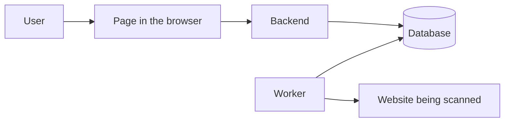

# Learn your project, one step at a time

This guide is for someone who knows a little programming but is new to this project. Start with the big picture. Then follow one real action through the code. You do not need to understand every file on your first read.

## 1. What does your application do?

AccessAudit helps a person find possible accessibility problems on a website. For example, it can report an image without alternative text. The user enters a website address, starts a scan, and later reviews the findings. The application can save results and offer AI-generated repair suggestions.

An automated scan finds some problems, but it cannot prove that a website is fully accessible. People still need to test it, including with a keyboard and assistive technology.

## 2. What are the main pieces?

- **Frontend:** the pages and buttons the user sees. Its code is in [`frontend/src`](../../frontend/src).
- **Backend:** the part that receives requests, checks permissions and runs or schedules work. Its code is in [`backend/app`](../../backend/app).
- **Database:** a place where the application stores accounts, settings and scan results. The backend describes its tables in [`backend/app/models`](../../backend/app/models).
- **Worker:** a separate program that can take a waiting scan and perform it. Its entry point is [`scan_worker.py`](../../backend/app/scan_worker.py).

The arrows show who communicates with whom. The worker reads waiting scan jobs from the database and saves progress there. The page asks the backend for updates. In another execution mode, some scans run inside the backend process instead.

## 3. Learn a few useful words

- An **API** is a set of addresses that one part of a program can call to ask another part to do something or return information. For example, the dashboard sends a scan request to `/scan/page`.
- A **component** is a reusable piece of the page, such as a button or a panel.
- **State** is information a page remembers while a person uses it, such as whether a scan is running.
- A **hook** is a React function that lets a component use state or other React features. [`useDashboardScan`](../../frontend/src/hooks/useDashboardScan.ts) keeps track of the scan process.
- A **repository** is a group of functions that reads or changes database records. [`scan_repository.py`](../../backend/app/repositories/scan_repository.py) handles many scan records.
- A **migration** is a recorded change to the database structure. See the [migration guide](../architecture/database-migrations.md) before running one.

## 4. Follow a real scan

1. The user opens the [dashboard](<../../frontend/src/app/(dashboard)/dashboard/page.tsx>) and enters a website address.
2. The dashboard uses [`useDashboardScan`](../../frontend/src/hooks/useDashboardScan.ts). Its `handleScan` function sends the address and scan options to the backend.
3. The backend receives the request in `scan_single_page` in [`main.py`](../../backend/app/main.py). It checks the user's session and combines the request with saved preferences.
4. In worker mode, the backend saves a waiting job and returns its ID. The [worker](../../backend/app/scan_worker.py) takes the job and calls [`scan_page`](../../backend/app/services/page_scanner.py).
5. The scanner visits the page and runs checks. The worker saves progress and findings through the [scan repository](../../backend/app/repositories/scan_repository.py).
6. While it waits, the dashboard repeatedly asks for the saved scan. It shows progress and then the result.

If the scan stays waiting, check whether the worker is running and using the same database as the backend. If a scan fails, check its saved error and the backend or worker logs. Do not share tokens or private user information from those logs. The [detailed scan guide](../modules/backend-scanning.md) explains other execution modes, cancellation and security limits.

## 5. Practice: try first, then check your answers

1. Find the function that sends a new scan request. Which address does it call?
2. Find the backend function that receives that request. Where does it obtain saved scan preferences?
3. Find the function that saves the final result of a worker scan. Does it check which worker owns the job?
4. Find the page that shows saved scan history. Does its sort operate on all saved scans or only the page currently loaded?

### Answers and explanations

1. `handleScan` in [`useDashboardScan.ts`](../../frontend/src/hooks/useDashboardScan.ts) sends a `POST` request to `/scan/page`. `POST` means it is asking the server to process new information.
2. `scan_single_page` in [`main.py`](../../backend/app/main.py) calls `get_preferences` and passes the result to `resolve_scan_settings`. Explicit request values can override saved values.
3. `complete_running_scan` in [`scan_repository.py`](../../backend/app/repositories/scan_repository.py) stores the final result. It looks up the scan by ID and does not check the current worker's identity. The [audit](../audits/code-quality-report.md) explains why this needs more testing.
4. [`ScanHistoryPage`](<../../frontend/src/app/(dashboard)/scan-history/page.tsx>) requests a page of results and sorts those loaded rows in the browser. Its sort does not order the entire history across pages.

## 6. Where should you go next?

Read the [module inventory](../module-inventory.md) to choose an area. Use the [frontend workflow guide](../modules/frontend-workflows.md) to follow pages, and the [backend scan guide](../modules/backend-scanning.md) to follow a scan through the server. The [onboarding guide](developer-onboarding.md) shows how to navigate, test and troubleshoot. The [progress tracker](../PROGRESS.md) says what still needs deeper explanation or verification.
