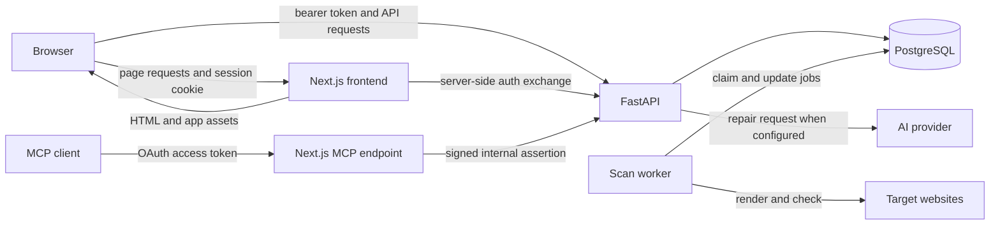

# Module inventory and reading guide

This inventory maps the repository as it exists in the working tree on 6 November 2026, including uncommitted MCP work. The [file inventory](file-inventory.md) lists tracked and non-ignored paths individually. These are navigation maps, not a claim that every function has been reviewed. See [progress and coverage](PROGRESS.md) for the remaining work.

## How the pieces fit

The browser renders a Next.js application. Authentication gives it an Auth.js session containing a backend token; authenticated requests use that token to reach FastAPI. FastAPI reads and writes PostgreSQL through SQLAlchemy repositories. In worker mode, a separate Python process claims queued scans and runs Playwright, custom checks and axe-core. Optional AI providers and MCP clients add separate integrations.

The diagram shows logical interactions, not proof that any service is currently deployed. Background execution mode also exists; it does not always use the separate worker. See [system architecture](architecture/system-architecture.md) and [MCP guide](guides/mcp-integration.md).

## Frontend modules

| Area | Entry points and responsibility | Main dependencies |
|---|---|---|
| App shell | [Root layout](../frontend/src/app/layout.tsx), [middleware](../frontend/src/middleware.ts), [dashboard shell](../frontend/src/components/dashboard/DashboardShell.tsx): shared providers, protected routes and workspace navigation. | Auth.js, preferences context, shared UI |
| Public pages | [Marketing routes](../frontend/src/app/(marketing)), [marketing components](../frontend/src/components/marketing): landing and about content. | Shared header, footer and UI primitives |
| Accounts | [Auth routes](../frontend/src/app/(auth)), [legacy signup route](../frontend/src/app/signup/page.tsx), [auth components](../frontend/src/components/auth): login, registration and password-reset screens. | [Auth context](../frontend/src/lib/contexts/AuthContext.tsx), [Auth.js options](../frontend/src/lib/auth-options.ts), backend auth API |
| Scans and dashboard | [Dashboard page](../frontend/src/app/(dashboard)/dashboard/page.tsx), [scan hook](../frontend/src/hooks/useDashboardScan.ts), [home components](../frontend/src/components/home): start scans, show progress, queue and findings. | Preferences, authenticated scan API, saved-scan mapping |
| Issues | [Issues page](../frontend/src/app/(dashboard)/issues/page.tsx), [issue components](../frontend/src/components/issues): select a scan and inspect, search and filter findings. | Saved scans API and local mapping |
| History and comparison | [History page](../frontend/src/app/(dashboard)/scan-history/page.tsx), [history components](../frontend/src/components/scan-history): list, filter, navigate and compare scans. | Paginated saved-scan API and detail requests |
| Reports and repairs | [Reports page](../frontend/src/app/(dashboard)/reports/page.tsx), [report components](../frontend/src/components/reports): summaries, pages, AI suggestions and exports. | Saved scans and repair endpoints; browser print for PDF |
| Preferences | [Preferences page](../frontend/src/app/(dashboard)/preferences/page.tsx), [preference components](../frontend/src/components/preferences), [context](../frontend/src/lib/contexts/PreferencesContext.tsx): view, edit and reset saved settings. | Preferences API and authentication |
| MCP | [MCP route](../frontend/src/app/api/mcp/route.ts), [link route](../frontend/src/app/api/mcp/link/route.ts), [discovery routes](../frontend/src/app/.well-known), [MCP library](../frontend/src/lib/mcp): OAuth-protected remote read interface and account linking. | OAuth issuer/JWKS, internal backend bridge; currently uncommitted |
| Shared code and styling | [UI primitives](../frontend/src/components/ui), [libraries](../frontend/src/lib), [types](../frontend/src/types), [global styles](../frontend/src/app/globals.css), [public assets](../frontend/public). | React, Radix, Tailwind, API types |
| Frontend verification | [Unit/component fixtures and tests](../frontend/src/test), tests beside source files, [browser tests](../frontend/e2e), [Vitest config](../frontend/vitest.config.mts), [Playwright config](../frontend/playwright.config.ts). | Vitest, Testing Library, mocked browser API calls |

## Backend modules

| Area | Location and responsibility | Main dependencies |
|---|---|---|
| HTTP API and lifecycle | [main.py](../backend/app/main.py): FastAPI setup, auth, scans, history, queue controls, repairs, preferences, health and metrics. [mcp_routes.py](../backend/app/mcp_routes.py): internal MCP bridge. | Schemas, repositories, services, database session |
| Scan execution | [scan_worker.py](../backend/app/scan_worker.py), [page_scanner.py](../backend/app/services/page_scanner.py), [axe_scanner.py](../backend/app/services/axe_scanner.py), [scan_options_resolver.py](../backend/app/services/scan_options_resolver.py). | Playwright, axe-core, target sites, scan repository |
| Identity and data access | [auth service](../backend/app/services/auth_service.py), [auth repository](../backend/app/repositories/auth_repository.py), [auth models](../backend/app/models/auth.py), [auth schemas](../backend/app/schemas/auth.py). | Signed tokens, persisted sessions and password hashes |
| Persistence | [db.py](../backend/app/db.py), [models](../backend/app/models), [repositories](../backend/app/repositories), [schemas](../backend/app/schemas), [Alembic versions](../backend/alembic/versions). | SQLAlchemy, PostgreSQL, Alembic; tests often use SQLite |
| Preferences and AI repair | [preferences repository](../backend/app/repositories/preferences_repository.py), [repair repository](../backend/app/repositories/repair_suggestion_repository.py), [repair service](../backend/app/services/repair_suggestion_service.py), [bundle service](../backend/app/services/repair_bundle_service.py), [encryption helper](../backend/app/utils/encryption.py). | User preferences, scan issues, configured AI provider and encryption key |
| MCP bridge | [MCP routes](../backend/app/mcp_routes.py), [MCP auth](../backend/app/services/mcp_auth.py), [MCP repository](../backend/app/repositories/mcp_repository.py), [MCP models](../backend/app/models/mcp.py). | Signed internal assertions, linked identity and user-scoped reads; currently uncommitted |
| Cross-cutting | [URL validation](../backend/app/utils/url_utils.py), [rate limit](../backend/app/services/rate_limit.py), [metrics](../backend/app/services/metrics.py). | Runtime configuration and process-local state |
| Backend verification | [pytest tests](../backend/tests), [requirements](../backend/requirements.txt). | pytest, in-process API tests and test doubles |

## Operations, documentation and other files

| Area | Location and scope |
|---|---|
| Containers and deployment | [Production-style Compose](../docker-compose.yml), [development Compose](../docker-compose.dev.yml), backend and frontend Dockerfiles, [backend startup](../backend/start.sh). |
| CI | [Quality gate](../.github/workflows/quality-gate.yml): frontend typecheck, tests, build, mocked browser suite, backend compile and pytest. |
| Benchmarks | [scripts/perf](../scripts/perf): scan/database benchmark scripts and recorded JSON results; historical measurements are not current test results. |
| Existing guides and history | [Documentation index](README.md): architecture, design, guides, implementation history and feature tracking. Historical documents describe their own point in time. |
| Database assets | `database/` is referenced by repository guidance but contains no visible tracked files in this checkout; schema and migrations live under `backend/`. |
| Third-party and generated material | Vendored [axe.min.js](../backend/app/assets/axe.min.js) is third-party code; lockfiles describe dependencies. Installed dependencies, virtual environments, build outputs, caches and browser reports are excluded from the owned-code audit. Already tracked generated artifacts remain visible in the [file index](file-inventory.md) but are not treated as application logic. |
| Sensitive configuration | Environment files, including examples, were not opened as a user preference. Variable names and behavior are traced from code and committed operational documentation instead; no actual values are recorded here. |

## Scope and next steps

The table covers repository areas, but a named area is not automatically fully understood or verified. Follow the module guides from the [documentation index](README.md), then check [progress](PROGRESS.md) and the [audit](audits/code-quality-report.md). Function-by-function coverage, full contract tracing, live integration checks and independent validation remain open until individually evidenced.
