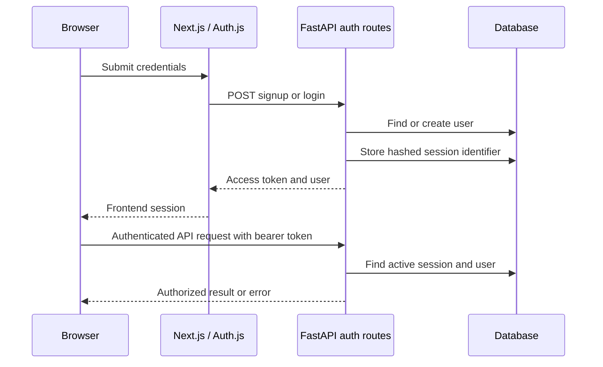

# Backend authentication: functions and data flow

This guide explains the **current working-tree implementation**, not a verified live deployment. Its scope is the authentication routes and helpers in [main.py](../../backend/app/main.py), [auth_service.py](../../backend/app/services/auth_service.py), [auth_repository.py](../../backend/app/repositories/auth_repository.py), and [auth schemas](../../backend/app/schemas/auth.py). The [auth models](../../backend/app/models/auth.py) define persisted users, sessions and password-reset tokens. MCP has an additional identity and token boundary and is not fully described here; see the [MCP guide](../guides/mcp-integration.md).

## What, why and how

The backend identifies a user using a signed access token **and** a matching active database session. The frontend's [Auth.js options](../../frontend/src/lib/auth-options.ts) exchange credentials or a Google profile for this backend token, and put it into the frontend session for API calls. Requiring a database session lets logout revoke a token before its signed expiry.

Google authentication and password reset have different entry points described below. The diagram represents the credentials path, not every auth request. The bearer token itself is sensitive; do not include it, passwords, reset links or configuration secrets in logs or documentation.

## Request and response schemas

FastAPI parses the request models in [schemas/auth.py](../../backend/app/schemas/auth.py); invalid shapes or field constraints normally produce an HTTP 422 validation response before the route runs. Model functions are Pydantic field validators, invoked during parsing rather than manually by route code.

| Model or validator | Inputs, output and behavior |
| --- | --- |
| `SignupRequest` | Requires `name` length 2–120, `email` length 5–255 and `password` length 8–128. `normalize_email` trims and lowercases, then checks for `@` and a dot in the part after the last `@`; this is a simple shape check, not email ownership verification. `normalize_name` trims and collapses whitespace and rejects an empty result. Field length checks occur before these after-validators, so normalization can shorten a value after length validation. |
| `LoginRequest` | Requires email length 5–255 and password length 1–128. Its `normalize_email` trims and lowercases but does not perform the signup email-shape check. |
| `GoogleAuthRequest` | Requires email, name and `google_sub` strings within their declared length ranges. Email is normalized and shape-checked like signup. `normalize_name` collapses whitespace and supplies a generic name if the normalized result is empty. The route requires `google_sub` in the body but does not use it when looking up or creating an account. |
| `ForgotPasswordRequest` | Requires email length 5–255; its validator trims and lowercases. |
| `ResetPasswordRequest` | Requires a token length 10–255 and new password length 8–128. It does not itself consume or validate a token against the database. |
| `UserResponse`, `AuthResponse`, `MessageResponse` | `UserResponse` returns string ID, name, email and creation timestamp. `AuthResponse` wraps the backend token and user. `MessageResponse` wraps a message. No password hash or reset-token hash is returned by these models. |

## Route functions in `main.py`

All routes below get a SQLAlchemy session from `get_db_session`. That dependency closes the session after the request; writes in the auth repository commit individually. Database exceptions are not translated into a dedicated auth error by these route functions.

### `signup(request, http_request, db)` — `POST /auth/signup`

**What and where used:** Called by the frontend credentials provider when signup is selected. It creates an account and an initial backend session; output is `AuthResponse`.

**How:** The request model normalizes the fields. `_enforce_rate_limit` checks the client identity; `get_user_by_email` looks for an existing email and returns HTTP 409 if found. `hash_password` creates a salted password hash; `create_user` inserts and commits the user. `create_session_token` then creates a signed token and identifier, and `create_user_session` stores a hash of that identifier in a separate commit. `to_user_response` maps the user for the response.

**Failure and edge cases:** A limit rejection is HTTP 429; an existing email is HTTP 409. The pre-check does not itself serialize concurrent signups, so database uniqueness also matters. User creation and session creation are separate commits: if the latter fails, the account may already exist even though the request failed. Signup does not verify email ownership.

### `login(request, http_request, db)` — `POST /auth/login`

**What and where used:** Called by the frontend credentials provider for password sign-in. Returns the same `AuthResponse` shape as signup.

**How:** Rate-limit by client identity; look up the normalized email; compare the supplied password with `verify_password`. Unknown users and wrong passwords both return HTTP 401 with the same error. On success, create the signed token and persisted session, then map the user. A malformed stored password hash makes verification return false rather than exposing parsing errors.

### `get_current_user(authorization, db)` — `GET /auth/me`

**What and where used:** Resolves an authenticated caller to `UserResponse`. It calls `_get_user_from_authorization_header`, which extracts and validates the bearer session before mapping the user. Missing or malformed authorization and invalid, expired, revoked or missing sessions produce HTTP 401. It reads the session and user but does not create a session.

### `logout(authorization, db)` — `POST /auth/logout`

**What and where used:** The frontend logout helper calls it with the backend token. `_get_bearer_token` requires a nonempty bearer header; `revoke_user_session` then marks the matching session revoked and commits if it can find one. The route returns `{ "logged_out": true }` even when the repository returns false for an invalid, expired, already-revoked or unknown token. A missing or malformed header produces HTTP 401. Frontend sign-out is a separate step; see [AuthContext](../../frontend/src/lib/contexts/AuthContext.tsx).

### `google_auth(request, x_oauth_proxy_secret, db)` — `POST /auth/google`

**What and where used:** The Next.js server calls this after its Google sign-in flow to obtain a backend session. The route expects a trusted forwarded profile and a shared proxy secret; it does not itself call Google to validate the profile.

**How:** Missing server configuration returns HTTP 503. A missing or mismatched header returns HTTP 401. Otherwise `get_or_create_oauth_user` looks up the normalized email, reuses an existing account for that email or creates a user with an unusable password hash, and returns a user. The route then mints and stores a backend session just like login.

**Constraint:** Account matching is by email, not `google_sub`; the correctness of the trust boundary depends on the frontend exchange and protection of the shared secret. A newly created Google user cannot normally use password sign-in until a password is set through an available reset process. The endpoint itself does not apply `_enforce_rate_limit`.

### `forgot_password(request, http_request, db)` — `POST /auth/forgot-password`

**What and where used:** Initiates password reset and returns a generic `MessageResponse` whether or not the email exists, to avoid directly disclosing account existence. It uses the auth rate limit.

**How:** For a known user, `generate_reset_token` produces a raw random token, its SHA-256 hash and an expiry. The route first commits invalidation of all unused reset tokens, then separately commits the new token hash and expiry. If `get_password_reset_link_logging_enabled` permits local logging, it prints a link containing the raw token. Otherwise the raw token is not delivered by this code.

**Failure and edge cases:** Email delivery is not implemented even though the generic response says a link has been sent. Never enable reset-link logging in an environment where logs are exposed. A failure between the two commits can invalidate old tokens without creating a usable replacement. Database and logging failures are not masked by the generic message.

### `reset_password(request, db)` — `POST /auth/reset-password`

**What and where used:** Accepts a reset token and replacement password and returns a success message. It does not use the auth rate-limit helper in this route.

**How:** Hash the supplied raw token with `hash_session_token`; `get_valid_reset_token` finds an unused, unexpired record and its user. If none exists, return HTTP 400. Hash the new password and call `update_user_password`, which commits it; then call `invalidate_unused_password_reset_tokens`, which commits invalidation of every unused reset token for that user.

**Failure and edge cases:** The password update and token invalidation are separate transactions. A failure between them can leave a reset token usable, and concurrent requests can both read it before invalidation. Password reset does not revoke existing user sessions in this route. These are current behavior and risks, not guarantees; see the [audit](../audits/code-quality-report.md).

### Authorization and rate-limit helpers

| Function | Inputs, output, callers and side effects |
| --- | --- |
| `_get_bearer_token(authorization)` | Requires a header beginning with the case-sensitive prefix `Bearer ` and a nonempty token after trimming; returns that token or raises HTTP 401. Called by logout and `_get_user_from_authorization_header`. |
| `_get_user_from_authorization_header(db, authorization)` | Calls the bearer parser and `get_user_for_token`; returns a `User`, or raises HTTP 401 if the token cannot resolve to an active session. Used by `/auth/me` and protected scan, history, preferences and repair routes. |
| `_client_ip(request)` | Returns the socket peer host or `unknown`; used as the identity for signup, login and forgot-password limiting. Behind a proxy, requests may share the proxy address. |
| `_enforce_rate_limit(request, scope, identity)` | Calls the [rate-limit service](../../backend/app/services/rate_limit.py), returns normally when allowed and otherwise records a metric and raises HTTP 429 with `Retry-After`. The in-memory limiter is per process, not a shared global limit. The `request` argument is not otherwise used by this function. |
| `get_password_reset_link_logging_enabled()` | Reads the named configuration flag and returns a boolean for `forgot_password`; it does not itself log or send anything. |

## Authentication service functions

These functions are in [auth_service.py](../../backend/app/services/auth_service.py). They do not access the database; repository and route callers determine persistence.

| Function | Input, result and behavior |
| --- | --- |
| `hash_password(password)` | Takes a string, obtains a random 16-byte salt, computes PBKDF2-HMAC-SHA256 with the configured iteration constant and returns an algorithm/iteration/salt/digest string. Signup and reset use it. It does not validate password length; request schemas do that. |
| `unusable_password_hash()` | Takes no input; creates random salt and digest in the same stored format. `get_or_create_oauth_user` uses it for newly created Google accounts. The random digest is not derived from a known password. |
| `verify_password(password, password_hash)` | Parses the stored format, checks the algorithm, recomputes the digest and uses constant-time comparison. Login calls it; malformed fields, unsupported algorithm or other exceptions return `False`. |
| `generate_reset_token()` | Creates a random URL-safe raw token, returns `(raw_token, sha256_hash, expiry)` with a one-hour expiry. `forgot_password` persists only the hash, while the raw token would be needed by a user. |
| `create_session_token(user_id)` | Takes a UUID and returns `(signed_token, random_jti, expiry)`. It sets subject, token identifier, issue time, expiry and access type; the current lifetime constant is seven days. Signup, login and Google auth call it, then persist the identifier hash separately. |
| `decode_session_token(token)` | Splits the signed token, checks the HMAC signature, decodes payload JSON and checks expiry, access type, and presence of subject and identifier. Returns claims or `None` on invalid or malformed input. It does not query the database, inspect the decoded header's algorithm, or independently compare `sub` to the session's user; current repository lookup uses the signed identifier. |
| `hash_session_token(token)` | Returns the SHA-256 hex digest of a string. It hashes reset tokens and session identifiers before storage and lookup; it is not the password-hashing function. |
| `_encode_jwt(payload)`, `_sign(value)`, `_get_jwt_secret()` | Build compact base64url header and payload segments, sign with HMAC-SHA256, and obtain the signing secret from runtime configuration. `_get_jwt_secret` has a local development fallback; a deployed system needs an appropriately managed secret. The encoder is called by `create_session_token`; the signer is also used by decoding. |
| `_b64encode`, `_b64decode`, `_b64url_encode`, `_b64url_decode` | Convert bytes to and from standard Base64 or URL-safe Base64; URL-safe encoding removes padding and decoding restores it. They are internal format helpers for password hashes and signed tokens. Invalid data can raise within a helper; `verify_password` and `decode_session_token` catch failures at their boundaries. |

## Repository functions and transaction boundaries

These functions are in [auth_repository.py](../../backend/app/repositories/auth_repository.py). Every function receiving `session` expects a SQLAlchemy session. Unless noted, queries return an ORM object or `None`; database errors propagate. Each listed commit belongs to that function, not automatically to a larger route-level transaction.

| Function | Inputs, calls, reads, writes and result |
| --- | --- |
| `get_user_by_email(session, email)` | Lowercases email and selects one user; returns `User` or `None`. Called by signup, login, forgot-password and `get_or_create_oauth_user`. It does not trim input itself. |
| `create_user(session, name, email, password_hash)` | Lowercases email, inserts `User`, commits and refreshes it, then returns it. Signup calls it after hashing; database uniqueness errors propagate. |
| `get_or_create_oauth_user(session, name, email)` | Looks up the lowercased email and returns an existing user unchanged, or creates one using `unusable_password_hash`, commits and refreshes. Called by Google auth. Concurrent creates rely on database constraints. |
| `update_user_password(session, user, password_hash)` | Replaces the user's hash, commits, refreshes and returns the user. Called by reset; it does not invalidate reset tokens or sessions itself. |
| `create_password_reset_token(session, user, token_hash, expires_at)` | Inserts the hash and expiry for a user, commits, refreshes and returns the row. Called by forgot-password after previous unused tokens are invalidated. |
| `invalidate_unused_password_reset_tokens(session, user)` | Selects all this user's rows whose `used_at` is empty, including expired rows, sets the current UTC timestamp, commits, and returns the number changed. Called by forgot-password and reset. |
| `get_valid_reset_token(session, token_hash)` | Selects a matching unused, unexpired token and eagerly loads its user. Returns the row or `None`; it does not lock or consume it. Reset calls it. |
| `consume_reset_token(session, reset_token)` | Marks a supplied token used and commits; returns `None`. No application caller was found in the inspected repository search. The reset route instead invalidates all unused tokens. |
| `create_user_session(session, user, token_jti, expires_at)` | Hashes the token identifier, inserts the user session and expiry, commits, refreshes and returns it. Signup, login and Google auth call it after signing a token. |
| `get_user_for_token(session, token)` | Decodes and checks the signed token; if valid, hashes its identifier and selects a non-revoked, unexpired session with its user. Returns the associated user or `None`. Used by the main authorization helper and the [MCP routes](../../backend/app/mcp_routes.py). The selected session determines the returned user; the query does not compare the signed subject claim to that user. |
| `revoke_user_session(session, token)` | Decodes the token and selects an unrevoked session by identifier hash. If found, sets `revoked_at`, commits and returns `True`; otherwise returns `False`. Logout calls it. Token decode checks signed expiry before the lookup. |
| `to_user_response(user)` | Converts the UUID and creation time to strings and returns `UserResponse`; it performs no database write. Signup, login, Google auth and `/auth/me` use it. |

## How to test and modify safely

Start with [auth unit tests](../../backend/tests/test_auth_unit.py), which exercise several helpers and repository paths with in-memory SQLite, and [API smoke tests](../../backend/tests/test_api_smoke.py), which substitute dependencies for several auth flows. See [testing and operations](../engineering/testing-and-operations.md) for commands and their limits. Add focused regression tests before changing a trust boundary, credential format, session expiry, authorization, error response or reset behavior; verify PostgreSQL concurrency separately where transaction ordering matters.

Do not assume that a signed token alone is sufficient: session lookup and revocation are part of the contract. Likewise, changing normalization, Google account matching, secret handling or reset-token transactions can affect existing users and clients. This document does not fully trace frontend screens, OAuth provider behavior, deployment configuration, MCP internals, every error path, or live identity-provider integration; those remain separate verification work.
