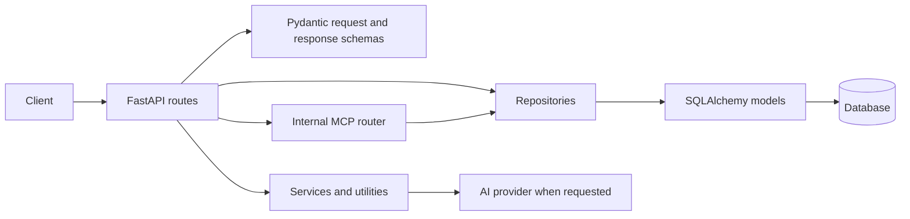

# Backend data, accounts and supporting services

This guide explains the backend foundations used by scanning. Read [Backend scanning](backend-scanning.md) for the scan request, crawl, worker and result lifecycle. Descriptions below reflect inspected code in this checkout; they do not establish production configuration or live behavior.

## What is here and why

[FastAPI's entry point](../../backend/app/main.py) defines most application routes and mounts the [internal MCP router](../../backend/app/mcp_routes.py). Pydantic schemas validate request bodies and shape responses. Repositories use SQLAlchemy to read and write model objects. Services contain operations such as password hashing, AI requests and scan analysis. These are practical boundaries in this repository: several route handlers still orchestrate more than one repository or service directly.

## Database sessions and model map

[`get_db_session`](../../backend/app/db.py) creates a session for a request and closes it afterward. `get_engine` and `get_session_factory` are cached per process; PostgreSQL pool settings come from configuration, while SQLite uses its own defaults. The dependency closes the session but does not automatically make a set of repository calls one transaction: many repository functions call `commit` themselves. When changing a multi-step workflow, inspect those commit boundaries and rollback/error behavior.

| Model | Table and purpose | Relationships and ownership |
| --- | --- | --- |
| [`User`, `UserSession`, `PasswordResetToken`](../../backend/app/models/auth.py) | Accounts, revocable session identifiers and reset-token hashes. | Sessions and reset tokens reference their user; user deletion cascades. |
| [`ScanRun`, `ScanIssueRecord`](../../backend/app/models/scan.py) | Scan job, status, progress, summary and ordered issue details. | A scan has a user ID, nullable for historical data; issues reference a scan and cascade on deletion. |
| [`AppPreferences`](../../backend/app/models/preferences.py) | Saved scan, AI, notification and appearance settings, including an encrypted provider key. | One row per non-null user ID is enforced by a unique column; legacy null ownership remains possible. |
| [`RepairSuggestion`](../../backend/app/models/repair_suggestion.py) | Generated explanation and code examples for an issue group. | Unique user/scan/group combination; the scan reference is set null if a scan is deleted. |
| [`McpAccountLink`, `McpRateLimit`](../../backend/app/models/mcp.py) | Map an external issuer/subject identity to a user and count MCP calls in a time window. | Both reference users; the rate-limit row is keyed by user. |

Database structure changes are represented by the [Alembic migration directory](../../backend/alembic/versions/). Do not assume the local migration files prove that a running database is at the same revision. Tests commonly use SQLite; production-specific locking and foreign-key behavior still need verification against the deployed database.

## Authentication and session flow

The routes and error handling are in [main.py](../../backend/app/main.py), input validation in [auth schemas](../../backend/app/schemas/auth.py), persistence in [auth repository](../../backend/app/repositories/auth_repository.py), and cryptographic helpers in [auth service](../../backend/app/services/auth_service.py).

1. `POST /auth/signup` validates name, email and password, applies the auth rate limit, checks for an existing normalized email, hashes the password, creates a user, then creates a session. A duplicate found by the preliminary lookup returns 409. Because creation and session creation commit separately, failure after user creation can leave an account without the requested session.
2. `POST /auth/login` normalizes the email, looks up the user and checks the stored password hash. Invalid credentials return the same 401 message. A successful login creates a session and returns the token and user details.
3. `POST /auth/google` accepts a profile forwarded by the trusted frontend after its Google exchange and checks a shared proxy secret. It reuses an account by email or creates one with an unusable local password hash. The backend trusts that proxy to have verified the profile; it does not independently verify the Google identity token in this route.
4. Protected handlers call `_get_user_from_authorization_header`: the bearer token is decoded and verified, and its session identifier is looked up in the database. Missing, expired, revoked or invalid sessions return 401. `GET /auth/me` returns the user; `POST /auth/logout` revokes the presented valid session when found.

`hash_password` uses PBKDF2-HMAC-SHA256 with a random salt; `verify_password` compares hashes and returns false for malformed or unsupported stored values. `create_session_token(user_id)` creates an HS256-signed access token with expiry and a random identifier; `create_user_session` stores a hash of that identifier. `get_user_for_token` requires both a valid token and an unexpired, unrevoked database session. The code has a development fallback for `AUTH_JWT_SECRET`; a real deployment needs a secure configured secret.

The [rate limiter](../../backend/app/services/rate_limit.py) uses in-memory token buckets. Scan limits are per user; signup/login/forgot-password use the client socket IP. Each API process has its own buckets, so limits multiply across processes. Behind a proxy, several users may appear to share the proxy's IP unless deployment-level handling is configured.

### Password reset: what actually happens

`POST /auth/forgot-password` returns the same generic message for known and unknown email addresses. For an existing user, `generate_reset_token` makes a random token and expiry; the handler invalidates older unused tokens and stores only a hash of the new one. The route can log a reset link when explicitly configured for local testing. **Email delivery is not implemented**, even though the generic response says a link has been sent. Never enable reset-link logging in a production environment.

`POST /auth/reset-password` hashes the supplied token, looks for an unused, unexpired matching row, hashes and stores the new password, then invalidates unused reset tokens for that user. An invalid or expired token returns 400. These last two writes commit separately in [auth repository](../../backend/app/repositories/auth_repository.py), and validation does not atomically consume the token. Concurrent requests or a failure between commits can violate the intended single-use behavior. Existing sessions are not revoked by this path. A safe change needs a transactional design and concurrency tests, not merely a documentation edit.

## Preferences and provider keys

The authenticated `GET /preferences`, `PUT /preferences`, and `POST /preferences/reset` endpoints call [preferences repository](../../backend/app/repositories/preferences_repository.py). `get_preferences(db, user_id)` finds the user's row or creates and commits defaults; it also fills a legacy null `skip_previously_scanned_pages` value. `update_preferences` uses only explicitly supplied fields, encrypts a nonblank new key, or clears it when `clear_api_key` is true, then commits. An empty submitted key does not replace the current key. `reset_preferences` deletes the existing row and inserts defaults, including removal of its saved key.

[Preference schemas](../../backend/app/schemas/preferences.py) set bounds on limits, depth, delays and notification score; notification severity values are normalized and deduplicated. Responses expose `has_api_key`, not the encrypted value. `encrypt_api_key` and `decrypt_api_key` in [encryption.py](../../backend/app/utils/encryption.py) use Fernet; a decryption failure returns `None`. The code falls back to a deterministic development key when `ENCRYPTION_KEY` is absent **or invalid**, so deployments must supply and protect a valid key. Rotating it without a migration makes previously encrypted keys unreadable.

Preferences are saved data, not proof that every listed option is implemented end to end. For example, notification preferences are stored, but this backend guide has not verified an email delivery service or application-wide enforcement of every appearance setting. Scan option resolution is described in [the scanning guide](backend-scanning.md).

## Repair suggestions and bundles

The scan owner can call `GET /scans/{id}/repair-suggestion-groups` to group issues, then `POST /scans/{id}/repair-suggestion-groups/{group_key}/generate` with optional `force`. The handlers first find the scan scoped to the current user; a missing scan or group returns 404. [`build_repair_suggestion_groups`](../../backend/app/repositories/repair_suggestion_repository.py) groups issue records using a normalized key derived from issue characteristics. It uses the first issue for shared details, collects affected pages and at most five examples, then sorts the groups. Saved suggestions are keyed by user, scan and group.

Generation returns an existing suggestion when present and `force` is false. Otherwise the route reads preferences, chooses provider/model, decrypts the key and calls [`generate_grouped_repair_suggestion`](../../backend/app/services/repair_suggestion_service.py). Missing or unreadable keys produce 400. The service supports OpenAI and DeepSeek request formats, sends a prompt containing group details and representative markup/location/text excerpts, parses the returned JSON into a validated draft, and reports recognized provider failures as 502 through the route. Thus an external provider receives selected issue content; review that content and provider policy before using it on sensitive pages. The generated suggestion is committed by `save_repair_suggestion`; it is guidance, not a code change applied to the scanned site.

`GET /scans/{id}/repair-suggestion-bundle?format=markdown` or `format=json` builds a response envelope containing filename, content type, group counts and text. The [bundle service](../../backend/app/services/repair_bundle_service.py) includes generated and pending groups; an unsupported format returns 400. See [repair tests](../../backend/tests/test_repair_suggestion_service_unit.py), [repository tests](../../backend/tests/test_repair_suggestion_repository_unit.py) and [bundle API tests](../../backend/tests/test_bundle_and_cancel_api.py) when changing this flow.

## MCP internal bridge

The MCP integration's public-facing frontend and OAuth setup are described in the existing [integration guide](../guides/mcp-integration.md). The backend portion is [mcp_routes.py](../../backend/app/mcp_routes.py). It is an internal bridge, not by itself the frontend's public MCP protocol endpoint.

* `POST /mcp/link` requires an application bearer session and a short-lived signed delegation assertion. It inserts a link for the asserted issuer/subject, or returns 409 if that identity already belongs to a different user. `DELETE /mcp/link` uses the application session and removes that user's links.
* `GET /mcp/identity`, `/mcp/scans`, `/mcp/scans/{id}` and `/mcp/scans/{id}/issues` validate the assertion and resolve the linked application user. Unknown links return 403. Scan queries are scoped to that user and use bounded limit/offset values; a scan belonging to another user returns 404. Returned issue fields are selected and bounded by the [MCP repository](../../backend/app/repositories/mcp_repository.py).
* [`verify_mcp_assertion`](../../backend/app/services/mcp_auth.py) checks signature, issuer, audience, scope, identity and a maximum 60-second lifetime. Missing configuration gives 503; an invalid assertion gives 401. The database-backed MCP rate limiter counts calls per user in fixed-minute windows, returning 429 when exhausted; its atomic insert/update supports PostgreSQL and SQLite.

This describes the implementation, not a claim that the integration has been deployed, linked or tested with a live MCP client. See [MCP tests](../../backend/tests/test_mcp_api.py) and the integration guide before changing trust or identity boundaries.

## How to extend safely

For a new authenticated endpoint, start from an existing route, define or reuse a schema, authenticate the bearer session, scope reads/writes to the user, and add focused tests for both the owner and a different user. Keep HTTP-specific decisions in the route where possible and database access in the relevant repository. For database changes, write a migration and test upgrade behavior; do not silently rewrite existing migrations. For a multi-write operation, explicitly decide which writes must succeed or fail together, and verify concurrent requests against the actual database engine. Never put real keys or access tokens in documentation, logs, tests or source control.

## Coverage limits

This guide covers main account flows, model relationships, session ownership, preferences, repair generation and the MCP bridge at their principal entry points. It does not document every schema field, repository helper, migration revision, AI provider edge case or frontend integration callback. No live login, reset, provider request, MCP connection or database migration was executed for this documentation; confirm deployed settings and runtime behavior separately.
