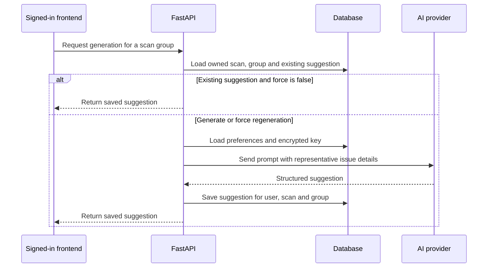

# Backend preferences and repair suggestions

This guide traces the working-tree implementation through the backend routes, schemas, repositories and services. It describes code inspection, not a live provider, database or browser verification. For authentication and bearer-token checks, read [backend authentication](backend-auth-functions.md). The frontend preferences and report controls are entry points, but their complete behavior is outside this guide.

## What these modules do

Preferences store a user's scan defaults, provider selection and key, notification choices and appearance choices. The scan endpoint reads some of these defaults and resolves explicit request overrides. Repair suggestions group similar findings from one saved scan, optionally send representative details to a configured external AI provider, and save one suggestion per user, scan and group. A separate bundle operation renders existing suggestions for download; it does not generate missing suggestions.

The actual provider request is a privacy boundary: although the prompt omits a separate page URL field and asks the model for generic output, representative markup, source hints, DOM paths and text previews can themselves contain sensitive information. Generated output and exports can also contain scan-derived content; review them before sharing.

## Request models and validation

The [preferences schema](../../backend/app/schemas/preferences.py) defines `AppPreferencesBase`, `AppPreferencesUpdate` and `AppPreferencesResponse`. Update inherits base fields and adds `api_key` and `clear_api_key`; response exposes `has_api_key`, not the raw or encrypted key. The schema constrains numeric scan settings and score threshold using field bounds. `normalize_notify_severities` trims and lowercases each allowed severity, removes duplicates in first-seen order, and raises a validation error for an unknown value. Other string fields such as provider, mode, theme and standard are strings rather than enumerations here; their later consumers have their own behavior. Invalid request models normally produce HTTP 422.

`AppPreferencesUpdate` has defaults, but the repository calls `model_dump(exclude_unset=True)`: an omitted field is not overwritten merely because a model default exists. Explicit values remain subject to the model's validation. A `has_api_key` value only reports whether ciphertext is present; it does not prove the key can be decrypted or accepted by a provider.

[Repair schemas](../../backend/app/schemas/repair_suggestion.py) define example details, a group with counts and optional suggestion, the suggestion fields, a group-list response, and a bundle envelope. `GenerateRepairSuggestionRequest.force` defaults to false. `RepairSuggestionAiOutput` in the [generation service](../../backend/app/services/repair_suggestion_service.py) requires nonempty explanation, impact and recommended fix strings and permits optional code and limitations. Its local model stores confidence as a string; the stricter OpenAI request schema also asks the provider to choose one of three confidence values.

## Preferences routes and repository

All three routes in [main.py](../../backend/app/main.py) resolve the backend bearer token to a user first. Missing or invalid authentication returns HTTP 401. Responses use `AppPreferencesResponse.model_validate` followed by a copy with `has_api_key` set from stored ciphertext; neither key is sent back. Database errors are not given special handling by these route functions.

| Route function | Inputs, calls, output and side effects |
| --- | --- |
| `get_app_preferences` — `GET /preferences` | Takes the authorization header; calls `get_preferences(db, user_id)` and returns the response model. Despite being a GET, a first request can insert and commit a default preferences row, and a legacy null crawl-memory flag can be repaired. |
| `update_app_preferences` — `PUT /preferences` | Takes validated `AppPreferencesUpdate`; calls `update_preferences` for the authenticated user and returns the resulting response. The repository updates only fields explicitly provided. |
| `reset_app_preferences` — `POST /preferences/reset` | Calls `reset_preferences` for the user and returns a fresh default row. Existing saved settings, including the encrypted key in that row, are removed; this is a data-changing action. |

The functions in [preferences_repository.py](../../backend/app/repositories/preferences_repository.py) take a SQLAlchemy session and user UUID:

- `get_preferences(db, user_id)` queries by user. If missing, it inserts, commits and refreshes a default `AppPreferences`; if `skip_previously_scanned_pages` is null, it sets it true and commits. Returns the row. This is also called by scan creation and repair generation, so those operations may create defaults.
- `update_preferences(db, user_id, update_data)` calls `get_preferences`, takes only explicitly set fields, and removes the key-control fields before applying regular attributes. `clear_api_key` wins if both key controls are supplied. A nonblank supplied key is passed to `encrypt_api_key`; an omitted, null or blank key without clear leaves the existing key alone. The original supplied nonblank string is encrypted, not its stripped version. It commits, refreshes and returns the row. A prior `get_preferences` may already have committed creation or repair.
- `reset_preferences(db, user_id)` finds and deletes the existing row if present, flushes the deletion, inserts a new default row, commits, refreshes and returns it. It does not itself delete scan history or generated suggestions.

`encrypt_api_key` and `decrypt_api_key` in [encryption.py](../../backend/app/utils/encryption.py) use Fernet. An empty input returns `None`; decryption errors return `None`. The key is selected when the module is loaded, and missing or invalid configuration falls back to a deterministic development key. See [deployment caveats](../engineering/testing-and-operations.md#deployment-and-configuration-caveats): changing encryption keys requires a plan for existing ciphertext, and presence of ciphertext is not proof of successful decryption.

### How scan defaults are used

The scan route gets preferences and passes the request and row to `resolve_scan_settings` in [scan_options_resolver.py](../../backend/app/services/scan_options_resolver.py). It chooses explicit non-null request fields first, then corresponding stored values and then code defaults. It normalizes mode and standard, converts pattern lists to tuples, and caps a multi-page request at five pages in this resolver; single mode gets no page limit. The resolved settings are used to construct scan options. Saving a preference does not prove every preference field has an active effect throughout the application: follow its callers before relying on it. In particular, a repository search for `auto_generate_suggestions` found storage and a frontend control but no generation consumer in the inspected application paths.

## Repair routes

Each route in [main.py](../../backend/app/main.py) first resolves the authenticated user and fetches the scan by both scan ID and user ID. An inaccessible or missing scan returns HTTP 404; an invalid bearer session returns HTTP 401. Inputs such as invalid UUIDs or request bodies can fail request validation.

### `get_repair_suggestion_groups` — `GET /scans/{scan_id}/repair-suggestion-groups`

The route fetches the owned scan, then calls `list_repair_suggestion_groups`. That function groups its issue records and attaches any saved suggestions for this scan and user. It returns `scan_id` and groups, including counts, representative examples and optional saved suggestion. This read does not call an AI provider.

### `generate_repair_suggestion_group` — `POST /scans/{scan_id}/repair-suggestion-groups/{group_key}/generate`

1. Fetch the owned scan and use `get_repair_suggestion_group` to locate the computed group; return HTTP 404 if absent.
2. Query an existing suggestion for user, scan and group. If found and `force` is false, return it immediately, without checking the current provider key or making an AI request.
3. Otherwise load preferences, normalize the selected provider, resolve the model, and decrypt the stored key. If decryption yields no key, return HTTP 400.
4. Call `generate_grouped_repair_suggestion`. A `RepairSuggestionGenerationError` becomes HTTP 502 with its message. On success, `save_repair_suggestion` inserts or updates the group result, commits, refreshes and returns it through `to_repair_suggestion_response`.

Generation has external cost, sends data to the provider and can fail independently of the database. Two simultaneous requests can both proceed past the existing-suggestion check; the model has a uniqueness constraint on user, scan and group, but the route does not implement a single-flight or conflict-retry mechanism. Do not assume `force` is a harmless read: it can make another provider request and overwrite the saved content.

### `get_repair_suggestion_bundle` — `GET /scans/{scan_id}/repair-suggestion-bundle`

The route loads owned-scan groups and calls `build_repair_bundle` with the `format` query parameter. It returns a JSON response envelope containing the rendered Markdown or JSON string, filename, content type and group counts. Unsupported format produces HTTP 400. It includes missing groups as missing instead of silently generating suggestions, and does not write suggestion records. Exported markup, suggestions, URLs and other scan details may be sensitive even though credentials are not intentionally included.

## Grouping and persistence functions

[repair_suggestion_repository.py](../../backend/app/repositories/repair_suggestion_repository.py) defines immutable `RepairSuggestionDraft` and `RepairSuggestionGroup` data classes. `group.affected_pages` returns unique nonempty page URLs in first-seen order; `group.examples` maps at most the first five issues to example fields, including page URL, markup and source details.

| Function | Inputs, output, calls and effects |
| --- | --- |
| `build_repair_suggestion_groups(scan_run)` | Groups the run's issues by `_group_key`, creates a group using the first issue's title, severity, recommendation and WCAG criteria, then sorts by descending issue count, severity and title. Returns in-memory groups; it does not write. |
| `_group_key(issue)`, `_normalize_group_text(value)` | Normalize rule, severity, message, WCAG criteria and source, then hash the joined representation and truncate the digest. Message normalization removes URLs, color hex values and numeric values before whitespace normalization. Page URL and DOM path are not separate key fields; different issues can consequently be grouped together. |
| `_group_title(issue)`, `_group_recommendation(issue)` | Turn occurrence-count wording into generic wording; use a generic contrast recommendation for a contrast rule and otherwise retain the issue recommendation. Called while grouping. |
| `_unique_values(values)` | Returns nonempty unique values in first-seen order; used by affected pages. |
| `get_repair_suggestion_group(scan_run, group_key)` | Rebuilds groups, returns the matching group or `None`; generation uses it. |
| `get_existing_suggestion(session, scan_run_id, user_id, group_key)` | Queries one scoped suggestion; returns its ORM row or `None`. Called before generation and by save. |
| `list_repair_suggestion_groups(session, scan_run)` | Uses `_suggestions_by_group_key` to query suggestions scoped to the run and user, rebuilds groups and maps each via `_to_group_response`. Used by listing and bundle routes. |
| `save_repair_suggestion(session, scan_run, group, provider, model, draft)` | Looks up an existing scoped row or constructs one, copies group metadata and draft fields, adds it to the session, commits and refreshes. Returns the row; constraint or database errors propagate. |
| `to_repair_suggestion_response(suggestion)`, `_to_group_response(group, suggestion)` | Convert ORM/data-class values into response schemas and timestamps into strings; the latter includes optional mapped suggestion, pages and examples. No write. |

The [suggestion model](../../backend/app/models/repair_suggestion.py) owns the unique user/scan/group constraint. Its scan foreign key is nullable and configured to become null on scan deletion; verify the actual database migration and deployment before assuming a deletion outcome in a live database.

## AI generation functions

[repair_suggestion_service.py](../../backend/app/services/repair_suggestion_service.py) defines `RepairSuggestionGenerationError` and these functions. They return a draft or raise; they do not persist it.

| Function | What happens, including limits |
| --- | --- |
| `normalize_repair_suggestion_provider(provider)` | Uses the default for a falsey value, then strips and lowercases it. A whitespace-only string becomes empty rather than falling back after stripping. |
| `resolve_repair_suggestion_model(provider, model)` | Trims the model and selects provider-specific defaults when the model is empty or evidently belongs to the other supported provider. Unknown providers retain a nonempty candidate or use the general default; later generation rejects them. |
| `generate_grouped_repair_suggestion(provider, model, api_key, group)` | Normalizes provider/model and dispatches to OpenAI or DeepSeek; unsupported providers raise `RepairSuggestionGenerationError`. The route converts that error to HTTP 502. |
| `_generate_with_openai`, `_generate_with_deepseek` | Build provider-specific payloads using `_system_instructions` and `_build_prompt`, call `_post_ai_request`, extract output text, then parse it into a draft. The OpenAI request asks for a strict JSON schema; DeepSeek requests JSON object output, with a model-specific thinking setting. Both request bounded output. |
| `_system_instructions()`, `_build_prompt(group)` | Build the instructions and JSON context. The prompt carries rule, severity, title, recommendation, criteria, count and up to five examples with element, source hint, DOM path and text preview. Instructions request reusable text without site-specific wording; they do not guarantee the output or inputs are free of sensitive data. |
| `_post_ai_request(url, api_key, payload)` | Sends an HTTP POST with bearer authorization and a 45-second timeout. HTTP status failures are translated using `_extract_provider_error`; other HTTP errors become a generic reachability error. It then parses response JSON. Unexpected successful-response JSON or shape errors are not all wrapped by this function and therefore should not be assumed to become the documented HTTP 502. |
| `_extract_openai_output_text`, `_extract_chat_completion_output_text` | Select text from the respective provider response shape, returning `None` when the expected text is absent in the ordinary missing-output cases. |
| `_extract_provider_error(response)` | Attempts to read a provider error message from JSON and otherwise supplies a generic rejection message when JSON parsing fails or the message is missing. Provider-supplied error text can be forwarded to the client by the route. |
| `_draft_from_output_text(output_text)` | Rejects empty text, removes a simple surrounding JSON code fence, parses/validates against `RepairSuggestionAiOutput`, and converts blank optional code or limitations to `None`. Invalid schema produces `RepairSuggestionGenerationError`; it does not prove proposed code is safe or correct. |
| `_strip_json_fence(value)`, `_blank_to_none(value)` | Trim text and, respectively, remove a full enclosing Markdown fence or convert an empty optional string to `None`. Used only during draft parsing. |

## Bundle rendering functions

[repair_bundle_service.py](../../backend/app/services/repair_bundle_service.py) is an in-memory renderer; it does not fetch or generate suggestions itself.

| Function | Input, output and behavior |
| --- | --- |
| `normalize_bundle_format(value)` | Defaults a falsey value to Markdown, trims/lowercases and accepts Markdown or JSON; otherwise raises `RepairBundleError`. |
| `build_repair_bundle(scan_run, groups, bundle_format, generated_at)` | Normalizes the format, chooses the supplied time or current UTC time, divides groups by suggestion presence, renders content and returns a `RepairSuggestionBundleResponse` with counts and a filename. |
| `_scan_url`, `_scan_date`, `_format_score` | Pick final or requested URL, completion or start timestamp, and a display score with fallbacks. Called by renderers. |
| `_render_markdown`, `_render_markdown_group` | Build the document with metadata, generated groups and an explicit section for groups without suggestions; include code blocks and limitations when present. |
| `_render_json`, `_suggestion_payload` | Build JSON text with scan metadata and each group's optional suggestion fields. `_suggestion_payload` maps a suggestion to its export fields. |

## How to test and modify safely

Relevant checks include [preferences tests](../../backend/tests/test_preferences_unit.py), [grouping and persistence tests](../../backend/tests/test_repair_suggestion_repository_unit.py), [generation service tests](../../backend/tests/test_repair_suggestion_service_unit.py), [bundle tests](../../backend/tests/test_repair_bundle_unit.py), and [bundle API tests](../../backend/tests/test_bundle_and_cancel_api.py). They are useful targeted evidence but do not by themselves establish live-provider behavior, all production database transaction races, or safety of generated fixes. For commands and CI limits, see [testing and operations](../engineering/testing-and-operations.md).

Before changing keys, provider/model rules, group identity, authorization or export format, identify existing callers and persisted data, add tests for the intended behavior and review compatibility. This guide does not exhaustively trace the frontend, provider-side policies, all preference consumers, production migration state, or every unexpected provider response. Those require separate review and live verification.
