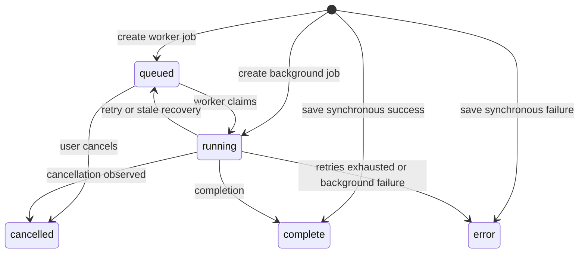

# Scan repository function reference

This page explains [scan_repository.py](../../backend/app/repositories/scan_repository.py), the persistence boundary used by the [scan API](../../backend/app/main.py) and [worker](../../backend/app/scan_worker.py). Read [Backend scanning](backend-scanning.md) for the user-facing flow and [scanner and worker functions](backend-scan-functions.md) for execution details. The function names below reflect the current checkout, not a guarantee that its database or services are deployed at the same revision.

## What it stores and how calls are made

[`ScanRun`](../../backend/app/models/scan.py) holds an owner ID, requested/final URLs, status, queue and worker state, dates, issue totals and score. `ScanIssueRecord` holds an ordered issue and references the scan. A scan's `user_id` is nullable in the model, including for legacy data; user-facing repository queries generally require an explicit matching user ID. Database foreign keys specify cascade deletion for issues; actual enforcement depends on the database configuration.

Functions accept a SQLAlchemy `Session`; they do not open or close it. Many functions **commit internally**. A commit applies pending work in that session, not only the fields named by the helper. Unless noted otherwise, database errors propagate to the caller; the functions are not a general rollback boundary. For example, the API explicitly rolls back if saving a synchronous scan or creating a job fails, while the worker handles unexpected scan errors. See [session creation](../../backend/app/db.py), the [history schemas](../../backend/app/schemas/history.py) and [scan schemas](../../backend/app/schemas/scan.py) for surrounding contracts.

This depicts intended paths, not enforced database state-machine constraints. Some internal write helpers use only the scan ID and do not check status or worker ownership before writing.

## Create and finish scans

### `save_completed_scan(session, *, user_id, requested_url, result, started_at, completed_at, mode="single", page_limit=None)`

The synchronous branch of `scan_single_page` calls this after a successful scan. It builds a `complete` run with page and summary fields from `ScanPageResponse`, computes duration and score, adds the run, flushes to obtain its ID, adds ordered issue records, then commits and refreshes the run. It returns the `ScanRun`; completion metrics are recorded afterward. Run and issue inserts are in the same commit, but a failure requires the caller to roll back. The function trusts the caller's result summary and issue list rather than recalculating the former from the latter.

### `create_scan_job(session, *, user_id, requested_url, started_at, mode="single", page_limit=None, status="running", scan_options=None)`

The API calls this for asynchronous execution. It creates the requested status, initializes empty page/queue arrays, zero counts, no worker lock/heartbeat and three maximum attempts, stores the supplied option dictionary, commits, refreshes and returns the row. The API uses `queued` for worker mode and `running` for background mode. The repository itself accepts the supplied status and does not authenticate the caller.

### `save_failed_scan(session, *, user_id, requested_url, error_message, started_at, completed_at, mode="single", page_limit=None)`

The synchronous API branch uses this when the scanner raises `ScanError`. It inserts an `error` run with no issue rows, zero counts, calculated duration and the message in both error fields, commits and refreshes it, records an error metric, and returns the run. The route attempts this write but still returns the scan error if recording the failure itself fails.

### `complete_running_scan(session, scan_id, *, result, completed_at)`

The worker and background task call this after scanning. It loads by ID and returns `None` if missing. Otherwise it writes `complete`, final URL, page counts and URLs, duration, score and cleared error/worker fields; `_replace_scan_issue_records` deletes the old partial issues and inserts the final list with new positions and recalculated counts. It commits, refreshes and records completion metrics. It neither takes a user ID nor verifies the current status or attempt owner. The callers check for cancellation before invoking it, but that check and the completion write are not a single atomic operation.

### `fail_running_scan` and `retry_or_fail_running_scan`

Both accept a session, scan ID, error message and time, load by ID, and return the updated run or `None` when it is absent. If cancellation is pending they mark it cancelled and commit instead. `fail_running_scan`, called by the in-process background task, otherwise stores terminal `error`, completion time/duration, message and cleared worker state. `retry_or_fail_running_scan`, called by the worker, records `last_error` and clears worker state; it sets `queued` when attempts remain or `error` with completion information when exhausted. Each commits and refreshes; terminal cases record metrics. Neither helper verifies the worker identity or protects an already terminal row from every possible stale call.

## Claiming, recovery and cancellation

### `claim_next_queued_scan(session, *, worker_id=None)`

The worker loop selects the oldest `queued` row using `FOR UPDATE SKIP LOCKED`, or returns `None`. When this is a retry, it removes partial issue records and resets summary counts. It sets `running`, increments attempts, saves the worker ID, lock and heartbeat times, clears current page and last error, then commits, refreshes and returns the run. The locking behavior must be checked on the actual database engine; SQLite-based tests are not proof of PostgreSQL concurrency behavior.

### `recover_stale_running_scans(session, *, stale_after_seconds)`

The worker calls this before claiming. It finds `running` rows whose heartbeat is absent or older than the threshold. A row with a cancellation request becomes cancelled; an exhausted row becomes `error`; otherwise it returns to `queued` and its worker lock/heartbeat are cleared. The function commits if it changed rows, otherwise rolls back the session, and returns the number handled. In particular, calling it with unrelated pending session changes would commit or roll back those changes too.

The selection is not restricted to a particular worker, and the code has no attempt-owner fencing on later progress or completion. A slow worker can be judged stale, then still write after a replacement starts. Background-mode running rows can also have no heartbeat before their first progress update, so mixed execution modes sharing a database need special care. Queue remove/prioritize actions can update the heartbeat without worker progress. These are code-level limitations to characterize with real concurrent sessions, not verified production incidents.

### `request_scan_cancel`, `is_scan_cancel_requested`, `mark_scan_cancelled`

* `request_scan_cancel(session, scan_id, user_id)` is called by the API and selects by **both** ID and user. It returns `None` for an inaccessible row. A `queued` row becomes `cancelled` immediately; a `running` row gets `cancel_requested_at` and remains running until observed; terminal rows are returned unchanged. Active changes are committed and refreshed. The route performs a prior check and returns 409 for a terminal scan, but that check and this update are separate operations.
* `is_scan_cancel_requested(session, scan_id)` reads only cancellation timestamp and status; it returns false for a missing row and true for a requested or already cancelled scan. Worker/background callbacks use it. This internal helper has no user argument.
* `mark_scan_cancelled(session, scan_id)` loads by ID for worker/background use. Missing rows return `None`; terminal rows are returned unchanged. For a nonterminal row, `_apply_cancelled_state` sets the terminal status, time and duration, clears queue/current page and worker state, preserves already saved issues, and sets the cancellation message. It commits, refreshes and records a metric. `_is_cancel_pending` tests for a request on a nonterminal row and is used by the failure helpers.

## Progress and issue rows

### `update_scan_progress(session, scan_id, *, current_page_url=None, queued_page_urls=None, scanned_page_urls=None, skipped_page_urls=None, issues=None)`

Callbacks in the worker and background task pass scan progress. The function fetches and refreshes the row by ID, returning without a write if missing. It always sets `current_page_url`; `None` for the other optional lists means leave that field alone. For a supplied queue it removes excluded URLs, preserves existing prioritized ordering for still-present entries and appends incoming entries. Supplied scanned/skipped lists are deduplicated and update their counts. Supplied cumulative issues go to `append_scan_issue_records`; the function updates `heartbeat_at` and commits. It has no user, status or attempt-ownership check.

### `append_scan_issue_records`, `_replace_scan_issue_records`, `_discard_partial_issue_records`

`append_scan_issue_records(session, scan_run, issues)` counts existing rows and reads their highest position, adds only the tail of the supplied cumulative list, updates counts from the complete supplied list, and returns the number added. It does **not** commit; its normal caller `update_scan_progress` does. This optimization assumes every published issue list has the earlier issues in the same order. A reordered or shortened list may leave persisted issue rows inconsistent with the summary until final replacement. The existing [repository unit test](../../backend/tests/test_scan_repository_unit.py) checks the number of rows after a reordered example, but does not assert their contents.

`_replace_scan_issue_records(session, scan_run, issues)` deletes the scan's current issues, adds all supplied issues in order and updates counts; its caller `complete_running_scan` commits. `_discard_partial_issue_records` deletes the scan's issues, resets summary counts and returns the deleted count; `claim_next_queued_scan` uses it before retry and commits. `_build_issue_record` maps a `ScanIssue` and position to a new model object; `_apply_issue_summary_counts` mutates the run using issue list length and severity counts. These helpers do not independently authenticate or commit.

## Queue controls

`get_scan_queue_state(session, scan_id)` loads and refreshes a row by ID and returns `(queued_urls, excluded_set)`, or empty collections when missing. Worker/background refresh callbacks call it; it does not accept an owner ID.

`remove_queued_scan_page(session, scan_id, user_id, url)` selects by scan and owner, returns `None` if missing and the unchanged row if not active. For an active row it normalizes the input, removes matching queued entries, adds it to exclusions even if it was not queued, updates heartbeat, commits and refreshes. The API converts `None` to 404.

`prioritize_queued_scan_page(session, scan_id, user_id, url)` has the same ownership and active-status checks. If a normalized match is present, it moves that URL to the front while preserving the remaining order, updates heartbeat, commits and refreshes. A nonmatching URL or terminal scan returns unchanged. Neither operation interrupts a page already being scanned.

## History, detail and deletion

`list_saved_scans(session, *, user_id, limit, offset, status=None, mode=None, q=None)` filters by owner and optional status, mode and case-insensitive substring search over requested/final URLs; it counts matches, fetches a page ordered by start time descending, and returns `SavedScanListResponse`. It batches fallback issue-page URL reads instead of loading each scan's full issue collection. The API validates pagination; the repository does not itself enforce the route's limit range.

`get_saved_scan(session, scan_id, user_id, *, include_issues=True)` returns a matching owned run or `None`. It uses `selectinload` for issues when requested. The history/detail and repair routes call it; `include_issues=False` is used for lightweight polling. `clear_saved_scans(session, user_id)` bulk-deletes **all** of the user's scan rows, commits and returns the count; it does not restrict deletion to terminal jobs. Issue deletion relies on configured database cascade for this bulk operation.

`to_saved_scan_list_item(scan_run, *, issue_page_urls=None)` maps row fields to the list schema, using final URL where present and constructing summary and date strings. If stored scanned-page URLs are empty, `_fallback_scanned_page_urls` includes the final/requested URLs and any supplied issue-page URLs. With `issue_page_urls=None`, it may load `scan_run.issues`; passing an empty list avoids that relationship read. Because the fallback also applies to queued or early running rows, an inferred URL in the response is **not proof** that it has been scanned; compare `pages_scanned` and status.

`to_saved_scan_response(scan_run, *, include_issues=True)` calls the list mapper and maps ordered issue rows to `ScanIssue` values; with false it returns an empty `issues` list without accessing the relationship. These mappers do not commit, but relationship access can cause a database query if the data was not eagerly loaded.

`_issue_page_urls_by_scan_run(session, ids)` selects scan IDs and non-null issue URLs in one query, orders by scan and issue position, then deduplicates per scan in Python; an empty input returns an empty mapping. `_unique_urls` preserves first occurrence while removing empty or exact duplicate strings. `_fallback_scanned_page_urls` deduplicates exact values and is used for older or not-yet-populated rows.

## Score, crawl memory and observability

`calculate_scan_score(result)` returns a rounded integer bounded between 0 and 100. It starts at 100 and subtracts `(12 × high + 4 × medium + low) / max(pages_scanned, 1)`. It has no database side effects and is a project-specific heuristic, not a conformance determination.

`get_previously_scanned_page_urls_for_domain(session, user_id, root_url)` is called by the API for multi-page crawl memory. It finds the root hostname, selects requested URL, final URL and scanned URL list from all of that user's completed scans, filters candidates to the same hostname in Python, normalizes them and returns a set. A missing/invalid host returns an empty set. It does not load issue rows; legacy rows with no page list still contribute requested/final URLs. `_normalized_host` lowercases the hostname and handles a parsing `ValueError`; `_normalize_crawl_memory_url` removes fragments and trailing slashes and lowercases scheme and network location. Same-host comparison is not the same as comparing full origins.

`_duration_seconds(started_at, completed_at)` returns nonnegative whole seconds. When only one datetime is timezone-aware it strips timezone information from that value before subtraction; callers should supply consistent timestamps to avoid ambiguous interpretation. `_record_scan_terminal_status` and `_record_scan_completion_metrics` call the [metrics service](../../backend/app/services/metrics.py); they catch and log metric failures so observability does not undo a completed persistence operation.

## Safe changes and coverage limits

Before changing ownership, state transitions or transactions, inspect both API and worker callers, test another user's scan, and test cancellation/recovery races on the deployed database engine. Relevant starting points are [repository tests](../../backend/tests/test_scan_repository_unit.py), [performance tests](../../backend/tests/test_perf_api_unit.py), [cancellation tests](../../backend/tests/test_scan_cancel_unit.py), and [API tests](../../backend/tests/test_bundle_and_cancel_api.py).

The repository functions and their principal production callers were inspected for this guide. It does not establish that every test or migration covers these behaviors, that a specific database has foreign keys enabled, or that concurrent execution behaves safely in production. No live database, multi-worker run or application test was executed to produce this document.
