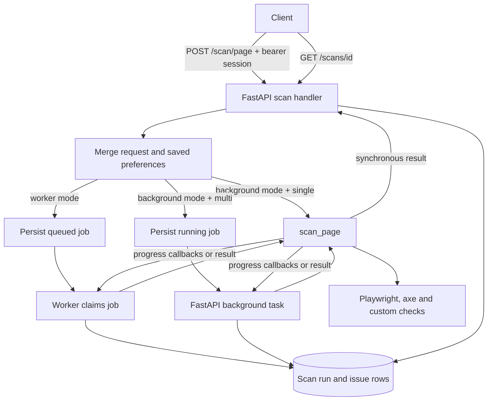

# Backend scanning: from request to saved result

This guide describes the code inspected in the current checkout. It is a map for following a scan through the backend, not a claim that every helper or runtime path has been verified. For accounts, preferences, AI repairs and database sessions, see [Backend data and services](backend-data-and-services.md).

## What and why

The scanner visits a supplied web page, detects accessibility issues and saves results for the signed-in user. A single-page scan can run inside an API request; a multi-page crawl, or any scan in worker mode, returns a scan ID while work continues. The saved record lets the interface poll status and show partial or finished results. The implementation combines custom HTML checks with axe-core analysis when browser analysis is available; these automated checks do not establish complete WCAG compliance.

Start with [the scan handler](../../backend/app/main.py), [request and response schemas](../../backend/app/schemas/scan.py), [scanner](../../backend/app/services/page_scanner.py), [worker](../../backend/app/scan_worker.py) and [scan repository](../../backend/app/repositories/scan_repository.py).

The diagram simplifies error paths. In particular, browser analysis can fall back to fetching raw HTML and running custom checks.

## Starting a scan

`POST /scan/page` calls `scan_single_page` in [main.py](../../backend/app/main.py). Its JSON body requires `url`; optional overrides include `mode`, `page_limit`, `crawl_depth`, delays, timeouts, ignored patterns, domain and robots controls, previously scanned page handling, WCAG standard and best-practice checks. [ScanPageRequest](../../backend/app/schemas/scan.py) validates the URL shape and numeric bounds; for example, the request allows page limits from 1 to 500 and timeouts from 1,000 to 60,000 milliseconds. The resolver currently caps a multi-page crawl at **five** pages even if a larger limit was requested or saved.

The handler:

1. Resolves the bearer token to an active user and applies the per-user scan rate limit. Missing or invalid sessions return 401; an exhausted limit returns 429 with `Retry-After`.
2. Reads or creates the user's preferences. [`resolve_scan_settings`](../../backend/app/services/scan_options_resolver.py) chooses an explicit non-null request value before a saved preference, and then defaults. For a multi-page scan with crawl memory enabled, [`get_previously_scanned_page_urls_for_domain`](../../backend/app/repositories/scan_repository.py) retrieves URLs from that user's completed scans on the same hostname.
3. Builds `ScanOptions`. In worker mode, it creates a `queued` row; in background mode a multi-page request creates a `running` row and schedules a FastAPI background task. Both return a response containing the scan ID, current status and initially empty issue/queue lists. The actual URL safety check in `scan_page` happens when execution starts, so an asynchronously submitted scan may become an error after the initial response.
4. In background mode, a single-page scan runs immediately. On success, `save_completed_scan` commits the scan and its issue rows and the result includes the ID. Validation errors return 400; a `ScanError` supplies an HTTP status and message, and the handler attempts to save the failure. Save failures are rolled back and reported as 500.

`ScanPageResponse` contains status, URL, page counts and lists, summary counts, issues and optional timings. Each issue carries a rule ID, severity, message, recommendation and optional location, page URL, screenshot and WCAG information. See the schema for exact fields; the saved-history response has its own [history schema](../../backend/app/schemas/history.py).

## Worker and job state

[`run_worker_loop`](../../backend/app/scan_worker.py) opens a database session on each polling iteration, recovers stale running scans, claims the oldest queued scan and calls `_run_claimed_scan`. It warms the axe cache and, by default, uses `WorkerBrowserManager` to reuse and periodically recycle a browser. A claim uses a row lock with `skip_locked`, increments the attempt counter and records worker ID and heartbeat. The loop closes its session each iteration and closes the browser when exiting.

The worker reconstructs options from the saved JSON payload, checks for cancellation, calls `scan_page` with a `CrawlQueueControl`, and either completes, cancels, retries or fails the row. Progress callbacks publish current page, queue, scanned/skipped URLs and accumulated issues. Cancellation is cooperative: a queued job can be marked cancelled immediately, while a running scan observes its flag at scanner checkpoints and after its final page. Partial issues are retained on cancellation.

[`recover_stale_running_scans`](../../backend/app/repositories/scan_repository.py) requeues stale jobs until attempts are exhausted, or marks them cancelled/error. A retried claim removes partial issue rows before restarting. **Concurrency limitation:** progress and completion writes identify the job by scan ID without proving that the caller still owns its current attempt. A worker that continues after being considered stale may race a replacement worker; this requires a concurrency-focused test and an ownership/fencing design before relying on recovery under that condition.

The in-process multi-page path uses `run_multi_page_scan_job` in [main.py](../../backend/app/main.py), rather than the worker retry loop. A process interruption can therefore leave background work unfinished; it should not be described as a durable queue.

## How the scanner visits pages

[`scan_page(url, options, queue_control, browser_session=...)`](../../backend/app/services/page_scanner.py) validates the starting URL, sets up timing and a browser session, and selects the single- or multi-page path. A caller-owned browser remains open; otherwise the scanner closes its own session. It returns `ScanPageResponse` or raises a validation/scan/cancellation exception. Timings are recorded in milliseconds by `PhaseTimer`; callers should check actual values rather than assuming the schema comment's stated unit.

For one page, `_scan_one_page` first tries rendered analysis when enabled. `_scan_rendered_page` navigates with Playwright, waits for rendered content, reads HTML, runs the custom parser and checks, and then attempts axe-core. [`build_axe_tag_values` and `run_axe_core`](../../backend/app/services/axe_scanner.py) map the chosen standard to axe tags, inject the axe script and turn violations into issue records. If axe fails, the scanner logs a warning and keeps custom findings. If rendered navigation is unavailable, the scanner fetches raw HTML, parses it and can run axe on a static, script-stripped version; failure of that analysis also leaves custom findings. Single-page analysis may capture screenshots; multi-page calls currently disable screenshot capture. Screenshot storage can use Cloudinary or a data URL depending on configuration and failure handling.

The multi-page path scans the starting page, derives normalized links and processes a queue until it reaches the resolved page limit or another stopping condition. `_build_next_page_queue` removes fragments and unsuitable links, applies ignored patterns, optional same-host restrictions and crawl memory. For later candidates it can check `robots.txt`, delay between requests and skip a page that raises `ScanError`; a time budget can terminate the crawl. The current code scans the **starting page before checking robots rules**. A robots failure is treated as allowed. See `_scan_multiple_pages`, `_normalize_discovered_url` and `_is_allowed_by_robots` in [page_scanner.py](../../backend/app/services/page_scanner.py).

### Target safety limitation

[`validate_public_http_url`](../../backend/app/utils/url_utils.py) rejects unsupported schemes, embedded credentials and overly long URLs. When `SCAN_ALLOW_PRIVATE_TARGETS=false`, it also resolves the host and rejects non-global IP addresses. The default permits private targets for local use. Even with the setting disabled, current browser navigation and raw `urlopen` redirect handling reach a destination **before** the final URL is checked, and browser subrequests are not controlled by that check. A public page or redirect can therefore cause a private-network request before rejection. Use network egress restrictions and treat pre-request redirect/subresource enforcement and DNS rebinding protection as unresolved security work. Existing final-URL tests do not establish that the destination was never contacted.

## Saving, viewing and controlling results

[`ScanRun` and `ScanIssueRecord`](../../backend/app/models/scan.py) hold the job, counts, URLs, timestamps, queue/worker state and ordered issues. `update_scan_progress` refreshes the row, merges queue state while honoring exclusions, appends newly accumulated issue rows, updates summary counts and heartbeat, and commits. On completion, `complete_running_scan` replaces issue rows with the final authoritative list and commits. `calculate_scan_score` starts at 100, subtracts 12 per high, 4 per medium and 1 per low issue divided by pages scanned, then rounds and bounds the score from 0 to 100; it is a project score, not a WCAG conformance result.

| Endpoint | Purpose and behavior |
| --- | --- |
| `GET /scans` | List the current user's scans with limit, offset, status, mode and URL search filters. |
| `GET /scans/{id}` | Load that user's scan, or 404. `include_issues=false` preserves the response shape but returns an empty issue list for lightweight polling. |
| `POST /scans/{id}/cancel` | Cancel a queued job or request cancellation of a running job; finished jobs return 409. |
| `POST /scans/{id}/queue/remove` | Exclude a supplied URL from an active queue. |
| `POST /scans/{id}/queue/prioritize` | Move a matching queued URL to the front. |
| `DELETE /scans` | Delete the authenticated user's scan rows; related issue rows are configured to cascade. |

All these routes authenticate using a bearer session and scope the initial lookup or query by user. Queue controls return the unchanged scan for terminal jobs or, for prioritization, a URL that is not queued. See [route handlers](../../backend/app/main.py) and [repository](../../backend/app/repositories/scan_repository.py) before changing behavior or response shapes.

## Debugging and safe changes

* A job stays queued: confirm the API is in worker mode, the worker process is running and can connect to the same database, then inspect worker logs and job state. Do not infer worker health solely from the API health endpoint.
* Results have fewer checks than expected: check logs for Playwright or axe warnings; the fallback deliberately returns custom issues when browser/axe work fails.
* A page is missing: check the five-page cap, depth, excluded patterns, same-host setting, crawl memory, robots decision and individual page errors. The start URL and later URLs follow different robots handling.
* Before changing queue state or cancellation, trace both execution modes and the UI polling contract. Add characterization tests for partial results, terminal states and concurrency as appropriate. Existing starting points include [scanner tests](../../backend/tests/test_page_scanner_unit.py), [worker tests](../../backend/tests/test_scan_worker_unit.py), [repository tests](../../backend/tests/test_scan_repository_unit.py), [cancellation tests](../../backend/tests/test_scan_cancel_unit.py) and [performance/security tests](../../backend/tests/test_scan_perf_unit.py).

## Coverage limits

This guide follows the entry point, major scanner and worker paths, state transitions, and selected persistence operations. It does not individually document every parser rule, screenshot helper, axe mapping, error branch or migration; consult the source and targeted tests before editing those areas. No live site, browser, database, or multi-worker deployment was exercised for this documentation.
