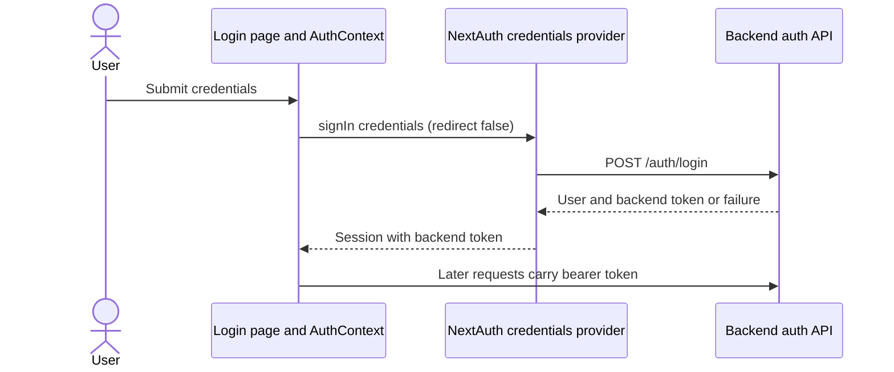

# Frontend authentication and preferences functions

This guide traces the inspected functions in [AuthContext.tsx](../../frontend/src/lib/contexts/AuthContext.tsx), [auth-options.ts](../../frontend/src/lib/auth-options.ts), [auth.ts](../../frontend/src/lib/auth.ts), and [PreferencesContext.tsx](../../frontend/src/lib/contexts/PreferencesContext.tsx). It explains the frontend's behavior; the backend is responsible for validating credentials, tokens, preference values, and ownership. See [Frontend pages and workflows](frontend-workflows.md) for the pages that call these functions.

## How the pieces fit

[RootLayout](../../frontend/src/app/layout.tsx) wraps all pages in `AuthProvider`, then `PreferencesProvider`. The order matters because the preferences provider calls `useAuth`. The [NextAuth route](<../../frontend/src/app/api/auth/[...nextauth]/route.ts>) exports the NextAuth handler for GET and POST using `authOptions`. [Middleware](../../frontend/src/middleware.ts) protects workspace paths, and [DashboardShell](../../frontend/src/components/dashboard/DashboardShell.tsx) also handles client-side session loading and redirects anonymous users. A UI guard is not a substitute for backend authorization.

## Auth provider and context functions

`AuthProvider({children})` creates the NextAuth `SessionProvider` and nests private `AuthContextProvider` inside it. `useAuth()` returns the context and throws when used outside `AuthProvider`. The provider reads `useSession()`: while NextAuth reports loading, status is `loading`; after that a non-empty `session.accessToken` yields `authenticated`, otherwise `anonymous`. It exposes the session user fields, token, and actions below. The client status is derived from the session; it does not independently call `/auth/me` on every render.

| Function | Inputs and outcome | Calls, effects, and errors |
| --- | --- | --- |
| `signIn` | Email, password, optional `remember` (default false); resolves without a value on success. | Calls NextAuth credentials sign-in with `mode: login`, the boolean converted to a string, and `redirect: false`. If the response is absent or not OK it throws a general invalid-credentials message. The [login page](<../../frontend/src/app/(auth)/login/page.tsx>) catches errors and navigates on success. |
| `signUp` | Name, email, password; resolves without a value on success. | Calls the same provider with `mode: signup` and `redirect: false`; it throws a general account-creation message when the response is not OK. The [register page](<../../frontend/src/app/(auth)/register/page.tsx>) subsequently calls `signIn` with remember enabled and navigates. The legacy [AuthCard](../../frontend/src/components/auth/AuthCard.tsx) instead calls `signUp` and then navigates. |
| `signInWithGoogle` | Optional callback URL, default `/dashboard`; resolves without a value after awaiting NextAuth. | Starts the Google provider flow. [GoogleButton](../../frontend/src/components/auth/GoogleButton.tsx) sets a loading state and catches a rejected start with a general message; the button is rendered even when the provider is not registered. |
| `signOut` | No arguments; resolves after local NextAuth sign-out. | When a backend token exists, first awaits `logout(token)`, then calls NextAuth sign-out with `redirect: false`. DashboardShell navigates to login after it resolves. A network rejection from backend logout interrupts this sequence before the local session is cleared. |

## NextAuth provider and callbacks

The server-side [auth-options.ts](../../frontend/src/lib/auth-options.ts) configures a credentials provider and conditionally registers Google when both provider credentials are present. The server auth API base URL can differ from the browser API base URL; configuration values are not reproduced here. The session uses NextAuth's JWT strategy with a seven-day maximum age, plus a separate logical expiry stored in the token.

### Credentials `authorize(rawCredentials)`

1. Normalize email by trimming and lowercasing, use an empty password if absent, and select `signup` only for that exact mode; all other values select `login`.
2. Return `null` if email or password is empty. Otherwise POST JSON to backend `/auth/signup` or `/auth/login`, including a trimmed name for signup.
3. Return `null` for a non-success HTTP response. For a successful JSON response, return a NextAuth user with ID, name, email, creation time, backend access token, and `remember` true only when the submitted string is `"true"`.

Network failures or invalid successful JSON can reject; this function does not catch them. Its response type is a TypeScript assertion, not runtime schema validation.

### Google `signIn` callback and `exchangeGoogleProfile`

For a non-Google provider, the `signIn` callback returns true. For Google, it takes email and subject from the provider profile with the coded user/account fallbacks; missing either rejects sign-in. It passes email, display-name fallback, and subject to `exchangeGoogleProfile`. That helper requires a server-side proxy secret, posts the profile and secret header to backend `/auth/google`, and returns a user carrying the backend token on success. A missing proxy secret or non-success backend response returns `null`; request and JSON failures can reject. On success, the callback copies backend identity/token fields onto the user and sets `remember` true. The route relies on the configured OAuth provider's identity flow and the backend exchange; it does not turn a Google token directly into a backend session in the browser.

### `jwt` and `session` callbacks

The `jwt({token, user})` callback runs with a user on initial sign-in and copies its backend access token and user fields. It records `expiresAt` as the current time plus seven days when remembered or twelve hours otherwise. With no new user it returns the existing token without resetting that timestamp.

The `session({session, token})` callback returns an empty access token when the stored logical expiry exists and has passed. Otherwise it copies the access token and user from the JWT into the session. The NextAuth cookie/session lifetime and this logical expiry are distinct; this callback does not itself revoke the backend token. AuthContext classifies a session with an empty token as anonymous. Backend token expiration and revocation must be enforced by the backend, independently of this client-facing state.

## Direct backend auth helpers

These functions in [auth.ts](../../frontend/src/lib/auth.ts) return promises. Unless stated otherwise, network or JSON parsing failures reject, and a non-success status becomes an `Error` using response JSON `detail` if readable, or `Request failed.` The response JSON is asserted to TypeScript types without runtime validation.

| Function | Input and result | How and where it is used |
| --- | --- | --- |
| `signup` / `login` | Signup payload `{name, email, password}` or login payload `{email, password}`; resolves to `{token, user}`. | Both call private `authRequest(path, payload)`, which POSTs JSON directly to the corresponding backend endpoint. Current page sign-in and signup use NextAuth's credentials provider instead; no static caller of these direct exports was found in the inspected `frontend/src` search. |
| `fetchCurrentUser` | Bearer token; resolves to `AuthUser`. | No-store `GET /auth/me`; no static caller was found in the inspected frontend search. Do not assume it runs automatically when context status changes. |
| `requestPasswordReset` | Email; resolves to the backend's `message` string. | POSTs `{email}` to `/auth/forgot-password`. The [forgot-password page](<../../frontend/src/app/(auth)/forgot-password/page.tsx>) displays the returned message or error. |
| `resetPassword` | Reset token and new password; resolves to the backend's `message`. | POSTs `{token, password}` to `/auth/reset-password`. The [reset page](<../../frontend/src/app/(auth)/reset-password/page.tsx>) reads the query token, checks the password length, displays errors, and navigates to login after success. |
| `logout` | Backend token; resolves without a value. | POSTs `/auth/logout` with bearer authorization. It does **not** check `response.ok`: an HTTP error response still resolves, while a network failure rejects. Its current caller is `AuthContext.signOut`. |

## Preferences provider and functions

`PreferencesProvider({children})` stores an `AppPreferences` object, `isLoading`, and an error string. Preferences include AI, scan, WCAG, notification and appearance fields. The in-memory defaults are a frontend fallback; they should not be assumed to be the current server defaults. `usePreferences()` returns this context and throws outside its provider.

### Initial and subsequent loads

The provider's effect calls private `fetchPreferences` when auth status or token changes:

1. If authentication is still loading, it returns without requesting data.
2. If there is no token, it marks loading false and restores the frontend defaults.
3. Otherwise it sets loading true, clears the error and sends authenticated `GET /preferences`. A successful JSON response replaces preferences; an HTTP error or network/parse failure sets an error string. The `finally` block marks loading false.

On load failure, the existing preferences object remains in state. The [preferences page](<../../frontend/src/app/(dashboard)/preferences/page.tsx>) reads preferences and loading, but does not currently display the context's load error. If a request is slow across sign-out/account changes, the effect has no cancellation or response-identity check: an earlier response can arrive later and overwrite defaults or another user's current in-memory preferences. Similarly, a delayed load can overwrite a more recent save response. These are potential ordering races inferred from the implementation; reproduce them with controlled request timing before changing behavior.

### `updatePreferences(newPrefs)` and API key handling

The input is a partial preferences object; on success the function updates context with the full response and resolves with no value. It throws if no token exists. It shallow-copies the input before constructing authenticated `PUT /preferences` with JSON.

The API key rule prevents an empty password input from unintentionally replacing an existing key: if `api_key` is defined but null, empty or whitespace, and `clear_api_key` is not truthy, the key field is removed from the outgoing copy. A nonblank key remains in the payload. When `clear_api_key` is truthy, a blank key is retained along with that flag. The [AI provider section](../../frontend/src/components/preferences/AiProviderSection.tsx) sets `clear_api_key: false` when typing and `api_key: ""` plus `clear_api_key: true` when Clear is pressed. The frontend sends the intent; backend behavior determines the actual key update.

On a non-success response the function throws `Failed to save preferences.`; network and parse failures also reject. It does not set the provider's load-error state for save failures. The page catches save failures and shows a generic toast. Its local draft is separate from context until Save, and Discard restores the current context value. See [AiProviderSection.test.tsx](../../frontend/src/components/preferences/AiProviderSection.test.tsx) for UI key-control coverage.

### `clearScanHistory()` and `resetPreferences()`

Both require a token and resolve with no value on success. `clearScanHistory` sends authenticated `DELETE /scans`; `resetPreferences` sends authenticated `POST /preferences/reset`, parses the returned preferences, and replaces context state. Each throws a generic message for a non-success status; network failures reject. [DangerZoneSection](../../frontend/src/components/preferences/DangerZoneSection.tsx) requests confirmation and reports success/failure to the user. The frontend does not itself implement the database deletion or preference reset.

## Maintenance and coverage limits

When changing these functions, follow the call chain through pages, NextAuth callbacks, backend auth/preferences endpoints, and tests. Characterize sign-out failure, delayed account-switch loads, key replacement versus explicit clearing, and expiry before changing their behavior. Existing [auth UI tests](../../frontend/src/components/auth/AuthAccessibility.test.tsx), [AI provider UI tests](../../frontend/src/components/preferences/AiProviderSection.test.tsx), and [browser auth tests](../../frontend/e2e/auth-login.spec.ts) cover selected interactions, not every race or live provider integration.

The four named frontend source files and the directly referenced UI paths were inspected for this guide. Third-party NextAuth internals, all dynamic callers, backend token issuance/revocation and transaction details, every preference consumer, live OAuth configuration, and browser/network failure scenarios were not independently verified here. No credential or configuration values are included.
