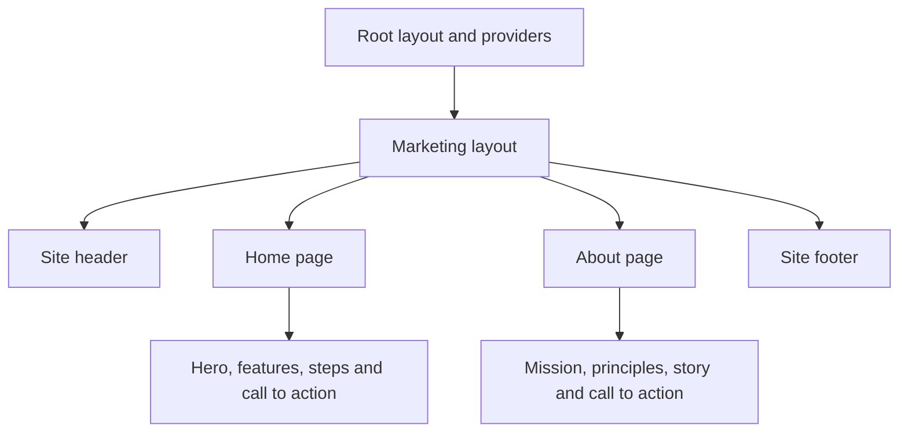

# Public pages, shared controls and styling

This guide explains how the working-tree frontend composes its public pages and reusable controls. It is based on source inspection; it does not establish that every control is accessible in every browser or that the displayed product claims have been independently verified. The [frontend workflow guide](frontend-workflows.md) covers the signed-in workspace, and [authentication and preferences](frontend-auth-preferences-functions.md) explains their state providers.

## Page composition and navigation

[RootLayout](../../frontend/src/app/layout.tsx) imports global CSS, sets the document language and metadata, applies Manrope through `next/font/google`, and nests `PreferencesProvider` inside `AuthProvider`. The order matters because preferences read the authentication context. The public route group adds [MarketingLayout](<../../frontend/src/app/(marketing)/layout.tsx>), which renders a skip link, header, page content and footer. Each public page supplies a focusable `<main id="main-content">` as the skip-link target.

### Home and about pages

[MarketingHomePage](<../../frontend/src/app/(marketing)/page.tsx>) renders these sections in order; they accept no props and do not themselves submit a scan:

1. [`Hero`](../../frontend/src/components/marketing/home/Hero.tsx) introduces the product and contains a **Run free scan** link to registration and an anchor to the process section. Its report card is hard-coded example content, not the result of a live scan.
2. [`TrustStrip`](../../frontend/src/components/marketing/home/TrustStrip.tsx) and [`Features`](../../frontend/src/components/marketing/home/Features.tsx) render static labels and a mapped set of product descriptions. The features section supplies the `features` anchor used by navigation.
3. [`HowItWorks`](../../frontend/src/components/marketing/home/HowItWorks.tsx) maps a static array into an ordered three-step list and supplies the `how` anchor. [`AccessibilityBand`](../../frontend/src/components/marketing/home/AccessibilityBand.tsx) presents a focus-indicator illustration and says automated checks should be paired with manual testing.
4. [`FinalCta`](../../frontend/src/components/marketing/home/FinalCta.tsx) links to registration and is shared with the about page.

[AboutPage](<../../frontend/src/app/(marketing)/about/page.tsx>) provides its own metadata and composes [`AboutHero`](../../frontend/src/components/marketing/about/AboutHero.tsx), [`ProblemStats`](../../frontend/src/components/marketing/about/ProblemStats.tsx), [`MissionProse`](../../frontend/src/components/marketing/about/MissionProse.tsx), [`Principles`](../../frontend/src/components/marketing/about/Principles.tsx), [`StoryBand`](../../frontend/src/components/marketing/about/StoryBand.tsx), and `FinalCta`. Despite its name, `ProblemStats` maps explanatory barrier examples rather than loading numerical statistics. The sections are static React output; their arrays and copy are defined in their respective modules.

Public copy mentions WCAG 2.2 and automated checks. Those statements are page content, not evidence that a scan proves conformance. Actual scan standard selection and limitations belong to the [backend scan documentation](backend-scanning.md).

### Header, footer and logo

[`SiteHeader`](../../frontend/src/components/marketing/SiteHeader.tsx) is a client component. `navLinks` holds home-section anchors and the About route; `isActiveLink(href, pathname)` marks a dedicated route active only on an exact pathname match and deliberately excludes anchors. The desktop and mobile navigations use those same entries. Login and registration links are rendered separately, with responsive visibility.

On small screens the menu button toggles local `menuOpen`, updates its accessible name and `aria-expanded`, and points `aria-controls` at the menu. While open, an effect listens for Escape; it closes the menu and returns focus to the menu button, then removes the listener when the effect is cleaned up. Selecting a mobile link or the logo calls `closeMenu`. This is a collapsible navigation, not a dialog or a focus trap; keyboard and screen-reader behavior still needs browser testing. The menu is hidden at larger breakpoints using CSS, rather than resetting its state when the viewport changes.

[`SiteFooter`](../../frontend/src/components/marketing/SiteFooter.tsx) maps static Product, Explore and workspace link groups and computes the displayed year when rendered. Workspace links lead to routes that have their own authentication guards. [`MarketingLogo`](../../frontend/src/components/marketing/Logo.tsx) renders the brand text and an icon hidden from assistive technology; the enclosing home links provide their own accessible label.

## Shared UI primitives

The files under [`components/ui`](../../frontend/src/components/ui) are project wrappers around native elements and Radix primitives. They forward the underlying component's props and merge caller classes with their default styles. They style and compose controls; they do not automatically know a form's label, validation rules, business action or user-facing error message. See the actual call site when diagnosing behavior.

| Component and source | What it accepts and how it behaves |
| --- | --- |
| [`Button`](../../frontend/src/components/ui/button.tsx) | Native button props plus `variant`, `size` and `asChild`; chooses default/destructive/outline/secondary/ghost/link styles and default/small/large/icon dimensions. With `asChild`, Radix `Slot` applies props and classes to its child, allowing a link to look like a button. The actual child still determines semantics; do not rely on a disabled button attribute to disable a link. A native form button needs an intentional `type` at its call site. |
| [`Badge`](../../frontend/src/components/ui/badge.tsx) | Span props and a `variant`, including both high/medium/low and critical/serious/moderate/minor styles. It is presentational text, not an interactive control; callers should not communicate severity by color alone. |
| [`Input`](../../frontend/src/components/ui/input.tsx), [`Label`](../../frontend/src/components/ui/label.tsx) | Input forwards native input props including `type`; Label wraps the Radix label primitive. Classes cover focus, disabled and invalid states, but a caller must associate the label with its control and expose meaningful error text. |
| [`Checkbox`](../../frontend/src/components/ui/checkbox.tsx), [`Switch`](../../frontend/src/components/ui/switch.tsx) | Wrap Radix roots and forward their controlled/uncontrolled state and event props. Checkbox shows an indicator and check icon; switch renders a thumb and an enlarged pseudo-element hit area. Callers supply an accessible label and choose how state is stored. |
| [`Dialog`](../../frontend/src/components/ui/dialog.tsx) | Exposes Radix root, trigger and close, plus styled content, header, title, description and footer. Content renders a portal and overlay and forwards Radix content props; it does **not** insert its own close button. Callers must compose an appropriate title, description and usable close action. The issue inspector and mobile workspace navigation are examples. |
| [`Select`](../../frontend/src/components/ui/select.tsx) | Wraps Radix root, group, value, trigger, content, label, item, separator and scroll buttons. Trigger supports `sm` and default sizes; content uses a portal and defaults to item-aligned positioning and centered alignment. The caller supplies labels, options and state; the wrappers use Radix's underlying interaction primitives. |
| [`Tabs`](../../frontend/src/components/ui/tabs.tsx) | Wraps Radix root, list, trigger and content. It forwards value, change and other primitive props; the list scrolls horizontally and active trigger styles use Radix state attributes. Callers provide tab labels and content. |
| [`ScrollArea`](../../frontend/src/components/ui/scroll-area.tsx) | Wraps a Radix root and viewport, renders a vertical scrollbar and corner, and forwards root props. The separately exported `ScrollBar` accepts an orientation and can be composed where a horizontal scrollbar is needed. It is a scroll container, not a substitute for an accessible content structure. |

[`cn(...inputs)`](../../frontend/src/lib/utils.ts) combines conditional class values with `clsx`, then resolves Tailwind class conflicts with `tailwind-merge`. This permits a caller's classes to override compatible wrapper defaults; inspect the resulting element and class order rather than assuming every override preserves focus or contrast.

## Global styles and operational details

[`globals.css`](../../frontend/src/app/globals.css) imports Tailwind and animation utilities, maps CSS variables into Tailwind theme values, and defines root colors, spacing, radii, font and shadow tokens. Base styles set a visible focus outline, smooth anchor scrolling, text wrapping and touch behavior. Component classes provide shared marketing width, spacing, headings and the initially hidden skip link. A `prefers-reduced-motion` media query reduces animation and transition durations and switches scrolling to automatic for users with that system preference.

The print rules hide workspace navigation, dialog chrome and skip links, adjust backgrounds and selected page spacing, and try to avoid breaks inside cards and tab content. They support the browser print/PDF flow, but do not prove every report will paginate correctly. [`components.json`](../../frontend/components.json) records shadcn-style aliases and the global CSS path; [`postcss.config.mjs`](../../frontend/postcss.config.mjs) enables Tailwind's PostCSS plugin.

Appearance and reduced-motion settings in the preferences UI are persisted as data, but this global stylesheet and root layout do not read those saved values. The system-level reduced-motion media query is separate; do not infer that changing a saved preference automatically applies a global theme or motion setting. Trace any new preference consumer through the [preferences guide](frontend-auth-preferences-functions.md).

## Verify changes and known limits

[Landing browser tests](../../frontend/e2e/landing.spec.ts) check the home hero, its registration link and the registration form. [Redesign browser tests](../../frontend/e2e/redesign.spec.ts) describe viewport, automated axe, mobile Escape/focus-return and print checks across selected pages; workspace API calls there are mocked. Their presence is not a claim that they passed in this documentation pass. Use the [testing guide](../engineering/testing-and-operations.md) for commands and CI limits.

Before changing a shared primitive, inspect its consumers, preserve intended element semantics, labels, focus, disabled behavior and error messages, then test the affected interactions on keyboard and at relevant viewport sizes. This guide does not exhaustively audit every primitive consumer, third-party Radix implementation, color contrast, screen reader, localization, remote font/build availability, actual print output or marketing claim. No browser or live application was run for this guide.
