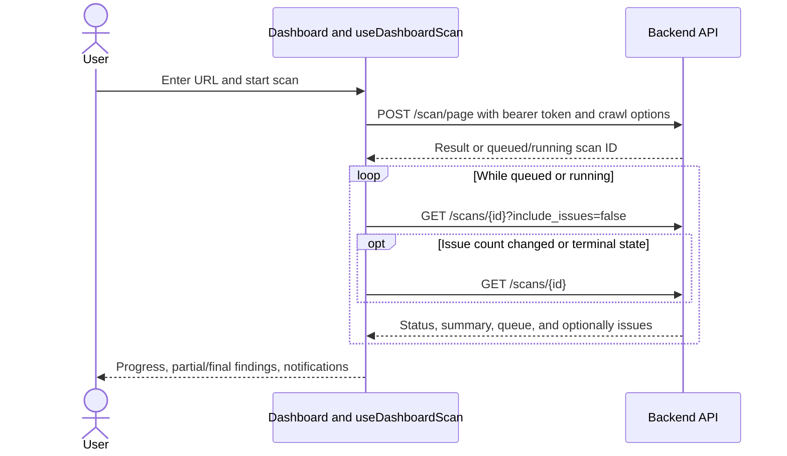

# Frontend pages and workflows

This guide follows the current Next.js implementation from a user action to the frontend request and response. It is an implementation guide, not evidence that a live service is running. For shared helpers and the MCP endpoint, read [Frontend shared code and MCP](frontend-shared-and-mcp.md).

## What the frontend does

The frontend presents public information and an authenticated workspace for starting accessibility scans, inspecting saved findings, comparing scans, viewing reports, and managing preferences. [RootLayout](../../frontend/src/app/layout.tsx) puts authentication and preferences providers around every route. [Middleware](../../frontend/src/middleware.ts) protects workspace paths with NextAuth; [DashboardShell](../../frontend/src/components/dashboard/DashboardShell.tsx) also waits for the client session and redirects anonymous users to `/login`. Backend authorization remains necessary: a frontend route guard alone does not protect API data.

| Route | Purpose and main implementation |
| --- | --- |
| `/`, `/about` | Public marketing pages: [home](<../../frontend/src/app/(marketing)/page.tsx>), [about](<../../frontend/src/app/(marketing)/about/page.tsx>), and their [layout](<../../frontend/src/app/(marketing)/layout.tsx>). Shared marketing components live in [components/marketing](../../frontend/src/components/marketing). |
| `/login`, `/register` | Credentials or Google sign-in, and account registration: [login](<../../frontend/src/app/(auth)/login/page.tsx>), [register](<../../frontend/src/app/(auth)/register/page.tsx>). |
| `/forgot-password`, `/reset-password` | Request a reset and submit a new password: [forgot password](<../../frontend/src/app/(auth)/forgot-password/page.tsx>), [reset password](<../../frontend/src/app/(auth)/reset-password/page.tsx>). |
| `/signup` | A separate legacy signup entry rendering [AuthCard](../../frontend/src/components/auth/AuthCard.tsx): [page](../../frontend/src/app/signup/page.tsx). |
| `/dashboard` | Start a scan and observe progress, queue, summary, and issues: [page](<../../frontend/src/app/(dashboard)/dashboard/page.tsx>). |
| `/issues`, `/scan-history`, `/reports`, `/preferences` | Inspect a saved scan, browse and compare history, view a report, or change settings, respectively. Their flows are detailed below. |

## Sign in and manage an account

**Why:** The backend requires its own bearer token on protected requests. NextAuth manages the browser session; the backend token identifies the user to the backend.

1. The [login page](<../../frontend/src/app/(auth)/login/page.tsx>) validates the email and password, then calls `signIn` from [AuthContext](../../frontend/src/lib/contexts/AuthContext.tsx). Registration validates name, email, password length and the terms checkbox, then calls `signUp` followed by `signIn`.
2. The credentials provider in [auth-options.ts](../../frontend/src/lib/auth-options.ts) trims and lowercases email, posts credentials to `/auth/login` or `/auth/signup`, and turns the response into a NextAuth user. Its JWT callback carries the backend token and an application expiry; the session callback exposes the token while that expiry is valid.
3. [AuthContext](../../frontend/src/lib/contexts/AuthContext.tsx) reports loading, authenticated, or anonymous based on the session and exposes `token`, `user`, sign-in and sign-out operations. Workspace components use this token with `authHeaders`.
4. Google sign-in is registered only if the relevant credentials are configured. The NextAuth callback exchanges the provider profile through backend `/auth/google` to obtain the same kind of backend token. The shared secret remains server-side.
5. Password reset pages call [auth.ts](../../frontend/src/lib/auth.ts): `requestPasswordReset(email)` posts to `/auth/forgot-password`; `resetPassword(token, password)` posts to `/auth/reset-password`. The reset page gets the token from its query string. Errors are shown in the form.

The credentials provider returns no user on a non-success response; the context translates that into a general sign-in or signup error. On sign-out, `AuthContext.signOut()` first calls backend `/auth/logout`, then clears the NextAuth session. A network rejection during the first step prevents the later local sign-out in the current implementation. The registration policy links currently point to `#`; do not describe them as published policy pages.

## Start, monitor, or cancel a scan

**What:** The [dashboard page](<../../frontend/src/app/(dashboard)/dashboard/page.tsx>) combines the toolbar, progress display, queue, notifications, metrics, and issue panels from [components/home](../../frontend/src/components/home). [useDashboardScan](../../frontend/src/hooks/useDashboardScan.ts) owns the interactive scan state.

1. `handleScan(mode, preferences)` rejects an empty URL, concurrent scan, or missing token. It clears earlier result/error state and posts the URL, mode, and crawl settings to `/scan/page`; the frontend caps `page_limit` at five.
2. While waiting, `beginProgress` uses a timer and random increments capped at 92%. This is an estimate, not a measurement of backend work. If the response is queued or running, `pollScanUntilComplete` waits two seconds between lightweight detail requests, up to 180 attempts. When issue totals change or the scan ends, it requests full details; that allows partial findings to appear without downloading them on every poll.
3. A completed scan is mapped to the dashboard response shape. A failed scan shows the backend error when supplied. A polling timeout tells the user to check Scan History; it does not itself stop the backend worker. Terminal in-app notices are derived by [scan-notifications.ts](../../frontend/src/lib/scan-notifications.ts) from the result and notification preferences.
4. Queue controls call `removeScanQueuePage` or `prioritizeScanQueuePage` in [saved-scans.ts](../../frontend/src/lib/saved-scans.ts). The cancel action calls `/scans/{id}/cancel`; when the backend reports a running scan with cancellation requested, the UI immediately treats it as cancelled and stops polling. The worker may finish the current page before stopping. Partial findings are retained when available.

**Debugging:** Check the `/scan/page` response first, then the saved-scan polling requests and status. A queued scan needs a functioning backend worker. If the progress number rises while no data changes, remember that the initial percentage is estimated. Check the hook's tests in [useDashboardScan.test.tsx](../../frontend/src/hooks/useDashboardScan.test.tsx) when changing polling or cancellation.

## Inspect issues

The [issues page](<../../frontend/src/app/(dashboard)/issues/page.tsx>) is reached from workspace navigation or a history entry with `?scanId=...`. It loads up to 50 saved scan summaries, chooses the requested ID if present in that list or otherwise the first result, then fetches the selected scan's full detail. `mapSavedScanToIssueList` converts each saved issue to display data, including the best available locator, WCAG information, screenshot, and a finder hint. The page filters the mapped list by page, severity, category, and text, sorts it, and tracks the selected issue for [IssueList](../../frontend/src/components/issues/IssueList.tsx) and [IssueDetailPanel](../../frontend/src/components/issues/IssueDetailPanel.tsx).

Loading and request errors appear in the page. A current limitation is that a requested scan outside the first 50 summaries is replaced by the first summary: a history link to an older scan can therefore show a different scan. Reproduce this before changing selection logic, and cover both a valid older ID and an inaccessible ID in tests.

## Browse and compare history

The [history page](<../../frontend/src/app/(dashboard)/scan-history/page.tsx>) requests ten scan summaries at a time. Search, status, and mode are sent to the backend with `limit` and `offset`; changing filters resets the page. Selecting an item opens `/issues?scanId=...`; its report action opens `/reports?scanId=...`. Comparison allows two selected IDs and [ScanHistoryCompareView](../../frontend/src/components/scan-history/ScanHistoryCompareView.tsx) fetches both full scans, orders them by start time, then compares issue keys and summary values.

Sorting is applied **after** each page is fetched, so oldest/most/fewest are ordered within the current page rather than across all matching scans. Comparison keys use rule, locator, and text but do not include page URL; matching findings on different pages may collapse in its maps. Treat both as current limitations when interpreting results, and add representative multi-page and multi-page-of-history tests before modifying the behavior.

## Read and export a report

The [report page](<../../frontend/src/app/(dashboard)/reports/page.tsx>) loads the `scanId` query parameter, or obtains the newest summary if no ID was provided. It fetches detail and calls `mapSavedScanToReportData`, then displays [ReportHeader](../../frontend/src/components/reports/ReportHeader.tsx), summary, page findings, and [AiSuggestionsTab](../../frontend/src/components/reports/AiSuggestionsTab.tsx). Missing scans and request failures produce an error/empty state with a way back to scanning.

The AI tab requests grouped findings, posts generation or regeneration for an individual group, and can request a Markdown bundle for download. The [export utilities](../../frontend/src/components/reports/export-utils.ts) construct CSV locally. Print invokes the browser print dialog; the PDF action also invokes that dialog with a temporary document title, so the user must select a PDF destination in the browser. `mapSavedScanToReportData` currently sets the report's WCAG label to `WCAG 2.1 AA`; it should not be assumed to reflect every scan's configured standard.

## Change preferences

The [preferences page](<../../frontend/src/app/(dashboard)/preferences/page.tsx>) displays a local draft from [PreferencesContext](../../frontend/src/lib/contexts/PreferencesContext.tsx). Each section updates the draft; Save sends it, and Discard restores the current context value. The context loads preferences for the authenticated token and calls `PUT /preferences` to save. A blank replacement API key is omitted unless explicit key clearing was selected. Reset calls `POST /preferences/reset`; Clear History calls `DELETE /scans`. Both destructive controls ask for confirmation in [DangerZoneSection](../../frontend/src/components/preferences/DangerZoneSection.tsx).

Saving a field establishes that it was sent and accepted, not that every setting is applied throughout the UI. For example, the dashboard explicitly reads reduced motion and scan defaults; verify each additional consumer before promising a global visual or notification effect. A failed load sets an error in the context, but this page does not currently display that context error. Its fetch also lacks a stale-response guard when the authenticated token changes.

## Coverage and safe changes

These traces describe major entry points and inspected paths, not every callback, visual state, API response, or backend transaction. The complete function-by-function inventory, live authentication/scan verification, all settings consumers, and full browser interaction review remain outstanding. Existing tests include [frontend unit tests](../../frontend/src) and [Playwright scenarios](../../frontend/e2e); read the relevant test and backend contract before changing a workflow. Add a focused test for changed behavior, run the appropriate suite, and update this guide only after checking the resulting implementation.
