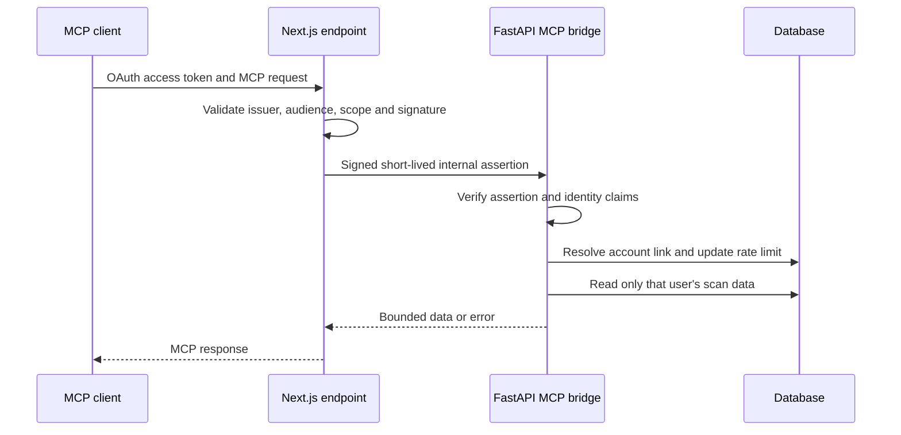

# MCP backend bridge: function reference

This guide follows the current working-tree implementation of the optional MCP bridge. The files were already uncommitted when this documentation work began. This is source inspection, not evidence that an identity provider, account link, migration or MCP client is configured or working in a deployment. Start with [frontend MCP](frontend-shared-and-mcp.md#mcp-what-it-is-and-why-it-exists) and the [integration guide](../guides/mcp-integration.md).

## What and why

An external OAuth identity does not automatically identify a local application user. The Next.js endpoint validates the client's token, then signs a short-lived internal assertion. The FastAPI bridge verifies that assertion and resolves its issuer and subject to a previously linked user. Repository queries filter saved scans by that user. MCP tools expose reading; linking, unlinking and rate-limit counters do write to the database.

Linking is a separate operation: it needs both a signed-in application session and a valid external identity. The frontend sends the app bearer token and the internal assertion to the backend. Unlinking removes links for the application user. See [link.ts](../../frontend/src/lib/mcp/link.ts) and [mcp_routes.py](../../backend/app/mcp_routes.py).

## Assertion and identity functions

| Function | Input, result and behavior |
| --- | --- |
| `authenticate(request, config)` | [Frontend auth.ts](../../frontend/src/lib/mcp/auth.ts) parses the bearer token, verifies its signature against the remote key set and checks issuer, audience, time claims, subject and `scans:read`. It caches a key-set client for the configured URL. It returns the external identity or throws a safe 401/403 error. It does not create an application account link. |
| `createDelegation(identity, config)` | The same file signs an HS256 internal assertion with the external subject and issuer, intended backend audience, scope and a maximum 60-second lifetime bounded by the external token expiry. It returns a token string; it does not write the database. |
| `verify_mcp_assertion(token)` | [Backend mcp_auth.py](../../backend/app/services/mcp_auth.py) checks configuration, token format, HMAC signature, header, issuer, audience, scope, external issuer, subject and timestamp constraints. It returns claims; missing configuration returns 503 and invalid assertions return 401. It does not look up the local user. |
| `mcp_identity_key(claims)` | Hashes a compact JSON pair of external issuer and subject to derive a stable link key. Called for link creation and lookup; not an authorization decision on its own. |
| `_bearer`, `_app_user` | [Routes](../../backend/app/mcp_routes.py) extract a bearer token; `_app_user` resolves an ordinary backend session to a user or returns 401. They are used when managing links. |
| `_mcp_user` | FastAPI dependency verifies the internal assertion, selects a link matching the key, issuer and subject, applies the MCP rate limit, and returns the local user UUID. A missing link gives 403. The rate limit operation commits a counter. Each protected read uses this dependency. |

## Routes and storage

All routes below are mounted under `/mcp` in [mcp_routes.py](../../backend/app/mcp_routes.py). They are an internal bridge used by the frontend; the external MCP endpoint has its own validation and protocol handling.

| Route and function | Inputs, output, database effects and errors |
| --- | --- |
| `POST /mcp/link`, `link_account` | Verifies both an internal assertion and local app session, enforces the local user's limit, and inserts a link if its identity key is free. A link already owned by another user causes rollback and 409; an existing link to the same user is accepted. It commits the link and returns `linked` and user ID. |
| `DELETE /mcp/link`, `unlink_account` | Resolves the app session, deletes all links for that user, commits and returns the deleted count. It does not require an external assertion in this route. |
| `GET /mcp/identity`, `identity` | Uses `_mcp_user` and returns the linked user ID. The dependency's rate-limit update is a write even though the endpoint returns identity data. |
| `GET /mcp/scans`, `scans` | Uses `_mcp_user`, accepts bounded limit/offset, optional status and URL search, and returns a page of that user's scan summaries. Invalid query values are rejected by FastAPI validation. |
| `GET /mcp/scans/{scan_id}`, `scan` | Returns one user-owned summary, or 404 when absent or owned by someone else. |
| `GET /mcp/scans/{scan_id}/issues`, `issues` | Validates the scan ID and bounded pagination/severity filters; returns that user's issue page or 404 for an inaccessible scan. |

The [models](../../backend/app/models/mcp.py) store issuer/subject-to-user links and one rate-limit counter per user. The [migration](../../backend/alembic/versions/9848b576f076_add_mcp_account_links.py) defines their schema in this working tree; its presence is not proof it has run on any database.

## Repository functions

Functions below live in [mcp_repository.py](../../backend/app/repositories/mcp_repository.py). They accept a SQLAlchemy session; database errors propagate unless a function handles them explicitly.

- `dialect_insert(db, model)` returns the PostgreSQL or SQLite dialect's insert builder; other dialects receive 503. It supports conflict-handling statements used by linking and rate limiting.
- `enforce_mcp_rate_limit(db, user_id)` validates the configured per-minute limit, calculates the current fixed minute window, and performs an insert or conditional update with `RETURNING`. It commits the counter before returning; an exhausted window produces 429 with `Retry-After`, and invalid configuration produces 503. The counter is shared through the database, unlike the separate in-process app limiter. Identity lookup and a later data request can each count toward the limit.
- `_summary(row)` converts selected columns to a bounded response with ID, chosen URL, status, dates, score and severity counts. It does not load screenshots or worker errors.
- `list_mcp_scans(db, user_id, limit, offset, status, q)` filters by user, optionally by status or URL text, counts matching rows and selects one ordered page. The query truncates URL columns. It returns pagination metadata and summary objects.
- `get_mcp_scan(db, user_id, scan_id)` selects one summary constrained by both ID and user and raises 404 if missing. An ID by itself does not grant access.
- `list_mcp_issues(db, user_id, scan_id, limit, offset, severity)` first checks ownership of the scan, then counts and selects issues in position/ID order. It bounds selected text and criteria, omits screenshots and returns pagination metadata. An inaccessible scan returns 404.

## Frontend dispatch and safe changes

`validateMcpOrigin` and `handleMcpRequest` in [http.ts](../../frontend/src/lib/mcp/http.ts) check request origin/resource, authenticate, mint delegation, resolve identity, and serve a stateless POST handler with bounded body size. The route also exports GET and DELETE to this handler; those receive 405 after authentication and identity lookup. Other methods are handled by Next.js and are not shown to follow that same sequence. `mcpErrorResponse` returns safe errors and authentication metadata where appropriate. `handleLinkRequest` in [link.ts](../../frontend/src/lib/mcp/link.ts) checks origin and the app session; POST also verifies the OAuth identity, while DELETE revokes the user's links.

`createAccessAuditServer` in [server.ts](../../frontend/src/lib/mcp/server.ts) registers `list_scans`, `get_scan_summary`, `list_scan_issues`, a guide resource and a review prompt. Its execution wrapper maps backend failures to safe tool errors. It explicitly treats webpage-derived content as untrusted evidence and warns that automated checks do not prove WCAG compliance.

### Frontend configuration and backend client functions

These functions operate on server-side requests. They read configuration from process variables, but this guide intentionally records names and behavior, not actual values.

- `configuredUrl(value, publicEndpoint)` in [config.ts](../../frontend/src/lib/mcp/config.ts) parses HTTP(S) URLs and rejects embedded credentials, query strings and fragments. Public URLs require HTTPS except loopback HTTP outside production; backend URLs are allowed HTTP. Invalid input throws to its caller.
- `getMcpConfig()` validates the resource path, issuer, key-set URL, internal secret length, backend URL and allowed origins, then returns the configuration used by handlers. It converts invalid or missing configuration to a safe 503 `McpHttpError`. `metadataUrl` constructs the metadata address, and `protectedResourceMetadata` returns the resource, authorization server and required scope. The [well-known GET route](../../frontend/src/app/.well-known/oauth-protected-resource/api/mcp/route.ts) returns this metadata with `no-store` or a safe error.
- `McpHttpError` carries an HTTP status, safe message, code and optional retry value. `mcpErrorResponse` uses these fields, hides unexpected exception details and adds appropriate authentication or retry headers. The link handler does not pass configuration into this error formatter, so its headers can differ from those of the main MCP handler.
- `readBoundedBody(response, maxBytes)` in [backend.ts](../../frontend/src/lib/mcp/backend.ts) reads a stream, cancels it and throws a 502 error if its cumulative byte count exceeds the limit, then combines the chunks. An absent response body becomes an empty byte array, which the JSON parser will reject later.
- `McpBackendClient.request(path, schema, init)` combines the incoming abort signal with a ten-second timeout, sends a no-cache request to the internal bridge with the assertion unless a caller supplies another authorization header, rejects redirects, maps selected HTTP errors to safe messages, bounds successful responses at 512 KiB and validates parsed JSON using the supplied Zod schema. Abort becomes 504; malformed or unexpected upstream data becomes 502. `identity`, `listScans`, `getScan` and `listIssues` construct the specific paths and query parameters and return validated response objects.
- `listScansInput`, `scanIdInput` and `listIssuesInput` are strict Zod input schemas with pagination and length bounds; `scanSummarySchema`, `scanListSchema` and `issueListSchema` describe bounded backend responses. The [server](../../frontend/src/lib/mcp/server.ts) registers these schemas with the protocol tools. Tool callbacks call the corresponding backend client method through `execute`, which returns structured/text content on success and a safe tool error on failure while logging the tool, user ID, outcome and duration.

When modifying this boundary, review both token types, issuer/audience/expiry, account linking, ownership predicates, rate-limit transactions, response bounds and [backend MCP tests](../../backend/tests/test_mcp_api.py) together with [frontend MCP tests](../../frontend/src/lib/mcp). This guide does not prove deployed OAuth, database concurrency or live client behavior.
